# SDOH Loops — User Manual

**For the public prototype at <https://feelingsarereal.github.io/sdoh-loops/>**
App build: `sdoh-loops-core` 0.10.0 with content pack 0.3.0 · research current as of 2026-10-23 · manual written 2026-11-05.
Every screenshot was taken from that build, at 1440 × 900 unless the caption says otherwise.

SDOH Loops lets you draw how a person's or a group's social circumstances connect, such as money, housing, work,
food, family and safety. Each circumstance is named with a WHO ICD-11 code. Every link you draw is checked against
the research the app carries. The app then finds the **feedback loops** that can hold a situation in place.

> **Read this first.** SDOH Loops is a thinking tool. It describes circumstances; it does not diagnose anyone, and it
> does not give medical, legal or financial advice. It is commissioned research, not peer reviewed. On the public
> prototype, **don't enter real client information**: what you type stays in your browser, but this is a test site.

---

## Contents

1. [Before you start](#1-before-you-start)
2. [Quick start: a map in five minutes](#2-quick-start-a-map-in-five-minutes)
3. [Every page: header, footer and banner](#3-every-page-header-footer-and-banner)
4. [My maps](#4-my-maps)
5. [The map screen at a glance](#5-the-map-screen-at-a-glance)
6. [Circumstances (the boxes)](#6-circumstances-the-boxes)
7. [The selection card: Read and Edit](#7-the-selection-card-read-and-edit)
8. [Following the research: Associations](#8-following-the-research-associations)
9. [Links (the arrows) and the evidence check](#9-links-the-arrows-and-the-evidence-check)
10. [Symbols on the canvas](#10-symbols-on-the-canvas)
11. [Quick look (the peek)](#11-quick-look-the-peek)
12. [The Whole map card: loops and analyses](#12-the-whole-map-card-loops-and-analyses)
13. [The toolbar in detail](#13-the-toolbar-in-detail)
14. [The Map menu: open, save, export, print](#14-the-map-menu-open-save-export-print)
15. [The side dock, list view, full screen](#15-the-side-dock-list-view-full-screen)
16. [The notebook](#16-the-notebook)
17. [The research pages](#17-the-research-pages)
18. [Phones, dark mode and the keyboard](#18-phones-dark-mode-and-the-keyboard)
19. [Worked example: Household F, after the fire](#19-worked-example-household-f-after-the-fire)
20. [Limits and good practice](#20-limits-and-good-practice)
21. [Troubleshooting and common questions](#21-troubleshooting-and-common-questions)
22. [Reference: keyboard shortcuts](#22-reference-keyboard-shortcuts)
23. [Reference: every control, A to Z](#23-reference-every-control-a-to-z)

---

## 1. Before you start

### What the app is for

A **map** in SDOH Loops is a causal loop diagram of one person's, household's or group's circumstances:

- **Circumstances** are boxes. Each one is something that can be more or less present, such as "Low income" or
  "Without a home". Most carry an ICD-11 code from Chapter 24, the codes WHO uses for social and economic problems
  (blocks QD50–QE9Z).
- **Links** are arrows. A **+** link means that, all else equal, more of the first leaves the second higher than it
  would otherwise have been. A **−** link means the opposite.
- **Loops** form where arrows lead back to where they started. A **reinforcing** loop (↻R) brings a change back
  pushing the same way, as in a vicious or virtuous circle. A **balancing** loop (↺B) brings it back pushing against
  itself.

The app checks every link against **23 evidence-graded links** from **69 verified references**, and it tells you
plainly when a link you drew isn't covered.

### What it is not

- It does not diagnose anyone, and it gives no clinical, legal or financial advice. ICD-11 codes here name
  **circumstances**, never conditions of a person.
- Weights, loop strength, leverage and the what-if pulse are **heuristics** for discussion. The app labels them as
  heuristics wherever they appear. They're not measurements or predictions.
- "Evidence" means a study in this app supports that pair of codes in that direction. It doesn't prove the link
  holds for the person in front of you.

### Where your work lives

Everything you type is saved **in this browser, on this device** (IndexedDB), as you type. Nothing is sent to a
server: there are no accounts, no sync and no analytics. Your work leaves the device only when **you** export it.
That has three consequences:

- Another browser, another computer or a private window starts empty.
- Clearing your browser's site data deletes your maps. So does **Clear my data** (see section 3).
- To keep or move a map, use **Map ▾ → Save a copy** (section 14).

### De-identify as you go

Under every text field the app repeats: *"Use initials or a label. Don't enter names, dates of birth, addresses or
record numbers."* Use a label such as "Household F" for the subject. The notebook has an identifier check, but it's
a heuristic and can miss things (section 16.4).

### If someone is in danger

The **Help** page lists crisis and support lines (988 Suicide & Crisis Lifeline, 211, the National Domestic
Violence Hotline, and 911 for immediate danger), each with its source and the date it was checked. The app itself
gives no advice.

---

## 2. Quick start: a map in five minutes

1. Open the site and read the **Before you start** notice. Then click **Start a map**.
2. On **My maps**, type a **Map name** and a **Subject** (initials or a label), then click **Create map**.
3. Click **New circumstance** (or press **N**). Search the codes in plain words ("rent", "job", "food"), click a
   code, give the box a short label, describe it as something that can go up or down, and click **Add circumstance**.
4. With a circumstance selected, click **Associations** (or press **A**) to see what the research links to it.
   Click **Add new** on a card, and the app adds the other circumstance and an evidence-backed link in one step.
5. To join two circumstances already on the map, select the first and click **Link to…** (or drag its **⊸**
   handle onto the other box). The dialog shows whether the evidence backs the link before you save it.
6. Open the **Loops** tab on the right to see the feedback loops. Click a loop to highlight it on the canvas.
7. Before you close the tab, use **Map ▾ → Save a copy** if you want the map outside this browser.

Prefer to explore first? Download the worked example,
[`household-f.sdohmap.json`](household-f.sdohmap.json), and open it with **My maps → Open a map file…**
(section 19 walks through it).

---

## 3. Every page: header, footer and banner

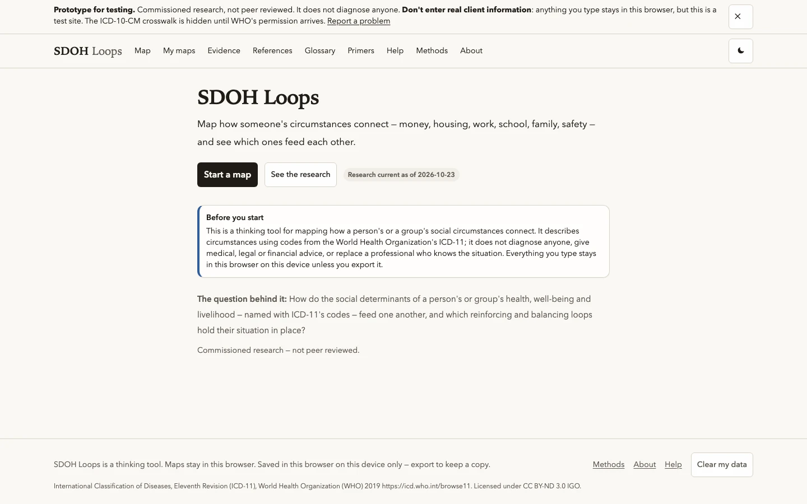
*The home page on a first visit. The prototype banner sits above the site header.*

### The prototype banner (public site only)

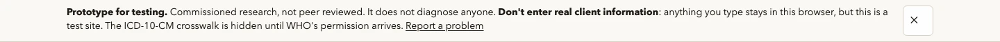

| Control | What it does |
|---|---|
| **Report a problem** | Opens the repository's Issues page on GitHub in a new tab. It's a plain link: nothing from the app is attached or sent. Describe the page and what went wrong; don't paste client details. |
| **✕** (*Hide this notice for this visit*) | Hides the banner while you move around the site. It comes back when you reload or open the site again, on purpose. |

### The site header

| Control | What it does |
|---|---|
| **SDOH Loops** (logo) | Goes to the home page. |
| **Map** | Opens the map you used last, or My maps if there is none. |
| **My maps** | Your saved maps, a new blank map, or a map file (section 4). |
| **Evidence · References · Glossary · Primers · Help · Methods · About** | The research and reference pages (section 17). |
| **☾ / ☀** (*Dark mode / Light mode*) | Switches the colour theme. The choice is remembered in this browser. |
| **Menu** | On narrow screens, the navigation folds into this button (section 18). |
| **Skip to main content** | Invisible until you press Tab on a fresh page; it jumps keyboard focus past the navigation. |

### The footer (every page)

- The line *"SDOH Loops is a thinking tool. Maps stay in this browser. Saved in this browser on this device only —
  export to keep a copy."*
- **Methods · About · Help**: shortcuts to those pages.
- **Clear my data** opens a dialog: *"Delete every map stored in this browser? This cannot be undone."* Confirm to
  delete every map, every notebook and every preference this app keeps in the browser, then return to the start.
  **Cancel** closes the dialog. Export anything you want to keep first.
- **WHO's citation**, required by the ICD-11 licence: *International Classification of Diseases, Eleventh Revision
  (ICD-11), World Health Organization (WHO) 2019 https://icd.who.int/browse11. Licensed under CC BY-ND 3.0 IGO.*

### The home page

| Control | What it does |
|---|---|
| **Start a map** | Opens My maps. |
| **See the research** | Opens the Evidence page. |
| **Research current as of 2026-10-23** | A date chip, not a button: how current the research behind the app is. |

### The first-run notice

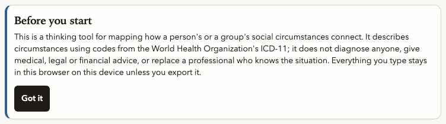

On your first visit, most pages show **Before you start**. **Got it** dismisses it for this browser. The same words
stay on the home page and the About page.

---

## 4. My maps

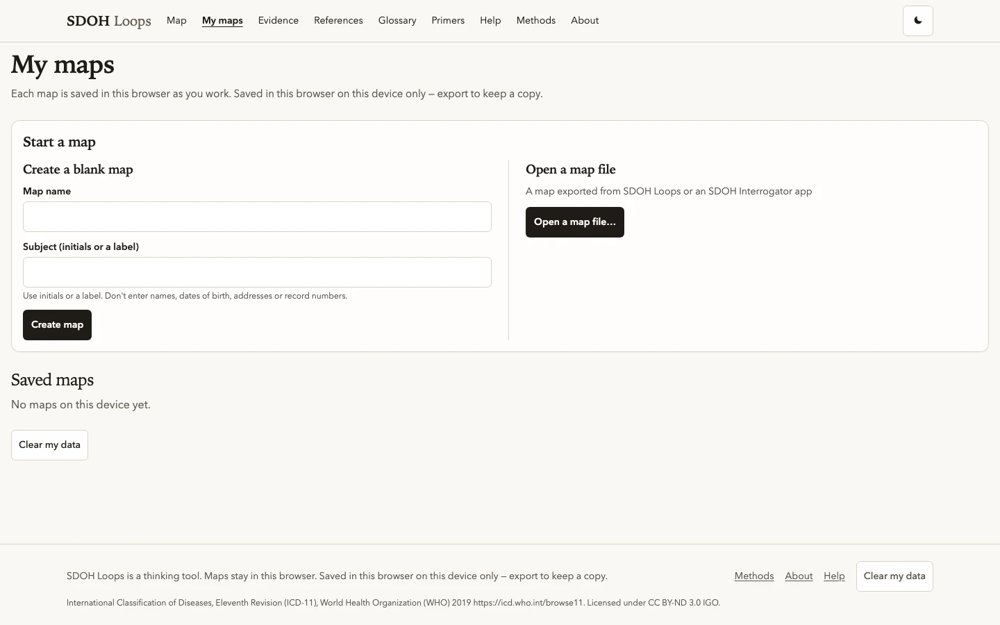

**My maps** has two ways in: **Create a blank map**, or **Open a map file**.

| Control | What it does |
|---|---|
| **Map name** | For you, for example "Household F, after the fire". |
| **Subject (initials or a label)** | Who or what the map is about. Use a label, never a name. |
| **Create map** | Creates the map and opens it on the canvas. |
| **Open a map file…** (⌘O / Ctrl+O on the map screen) | Opens a `.sdohmap.json` or `.sdohcase.json` file exported from SDOH Loops or an SDOH Interrogator app. The file becomes a **new** map named "… (imported)", and every link is checked again against this app's evidence. You can also **drop** a file onto the card. |

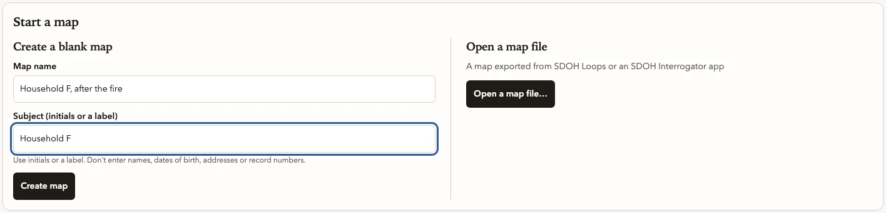

### Saved maps

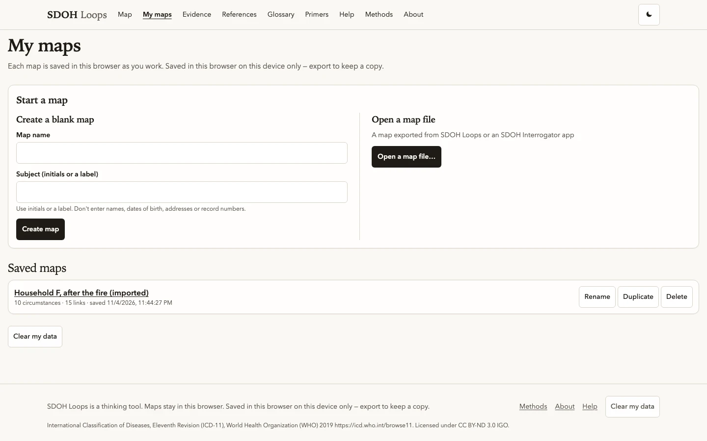

Each saved map shows its name, how many circumstances and links it has, and when it was last saved.

| Control | What it does |
|---|---|
| **The map's name** | Opens it. |
| **Rename** | Edits the name in place. |
| **Duplicate** | Makes a copy, for example to try a "what if we drew it differently" version. |
| **Delete** | Asks *"Delete this map from this browser? This cannot be undone."*, then deletes it. |
| **Clear my data** | As in the footer: deletes everything. |

---

## 5. The map screen at a glance

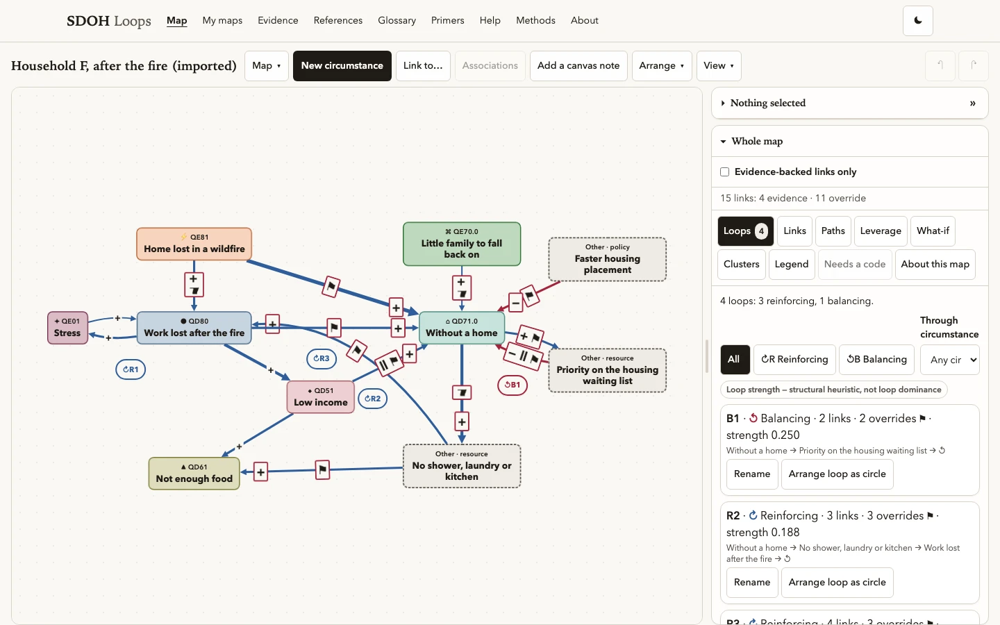
*The map screen with the worked example loaded.*

The screen has three parts: the **toolbar** across the top, the **canvas** on the left, and the **side dock** on
the right. The dock holds the *Selected* card and the *Whole map* card. The notebook, when it's open, sits between
the canvas and the dock.

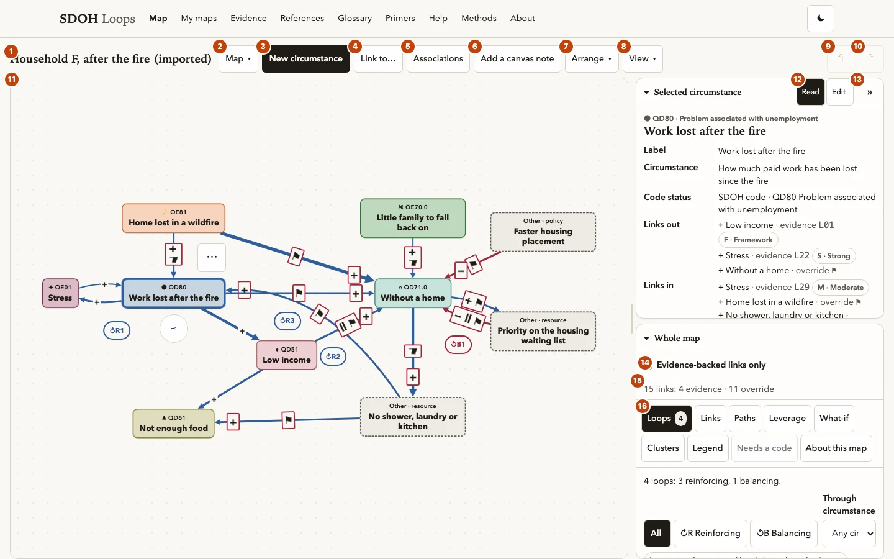

| # | Control | In short | Details |
|---|---|---|---|
| 1 | **Map name** | The current map. "(imported)" means it came from a file. | §4 |
| 2 | **Map ▾** | Open a map file, save a copy, every export, print / grayscale, import into the notebook. | §14 |
| 3 | **New circumstance** (N) | Add a box. | §6 |
| 4 | **Link to…** (K) | Draw a link from the selected circumstance. | §9 |
| 5 | **Associations** (A) | What the research links to the selected circumstance. Greyed out until a coded circumstance is selected. | §8 |
| 6 | **Add a canvas note** | A free-text sticky note on the canvas. | §13 |
| 7 | **Arrange ▾** | The layout, the arranging commands and the neighborhood highlights, listed below. | §13 |
| 8 | **View ▾** | Fit, zoom, full screen, the list view, the notebook, grayscale and the keyboard shortcuts, listed below. | §13, §15, §16, §22 |
| 9 | **Undo** (⌘Z) | Undo the last change. | §13 |
| 10 | **Redo** (⌘⇧Z) | Redo it. | §13 |
| 11 | **Canvas** | The drawing itself. | §6, §10 |
| 12 | **Read / Edit** (E) | How the Selected card shows the selection. | §7 |
| 13 | **»** | Fold the side dock to a thin rail (]). | §15 |
| 14 | **Evidence-backed links only** | Analyses use only evidence-backed links. | §12 |
| 15 | **Link count** | For example "15 links: 4 evidence · 11 override". | §9 |
| 16 | **Whole map tabs** | Loops, Links, Paths, Leverage, What-if, Clusters, Legend, Needs a code, About this map. | §12 |

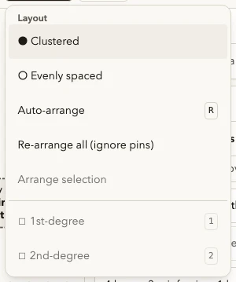 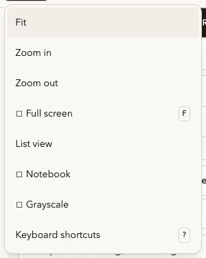

**Arrange ▾**

| Control | In short | Details |
|---|---|---|
| **Layout** | *Clustered* or *Evenly spaced*. | §13 |
| **Auto-arrange** (R) | Lay the map out again, leaving pinned boxes where they are. | §13 |
| **Re-arrange all (ignore pins)** | Lay out everything, pinned or not. | §13 |
| **Arrange selection** | Lay out only the selected boxes (two or more). | §13 |
| **1st-degree** (1) | Highlight the selection and its direct neighbors. | §13 |
| **2nd-degree** (2) | …and their neighbors. | §13 |

**View ▾**

| Control | In short | Details |
|---|---|---|
| **Fit** | Zoom to show the whole map. | §13 |
| **Zoom in**, **Zoom out** | Zoom in or out. | §13 |
| **Full screen** (F) | The workspace fills the screen; Esc leaves. | §15 |
| **List view / Canvas view** | Everything as tables, or back to the drawing. | §15 |
| **Notebook** | Show or hide the case notebook beside the map. | §16 |
| **Grayscale** | Gray boxes and patterned links, for printing in black and white. | §15 |
| **Keyboard shortcuts** (?) | The keyboard shortcuts. | §22 |

The link count sits at the top of the Whole map card. When the notebook is open, **Trace** appears in the View menu
below **Notebook** (§16.8). On a phone, **Link to…**, **Associations** and **Add a canvas note** are under **＋**.

---

## 6. Circumstances (the boxes)

### Adding one

Click **New circumstance**, press **N**, or double-click an empty spot on the canvas (the box appears there).

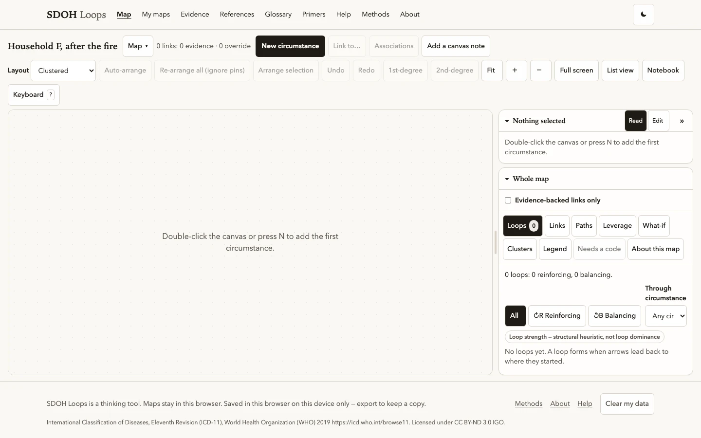
*A new map. The canvas says how to add the first circumstance.*

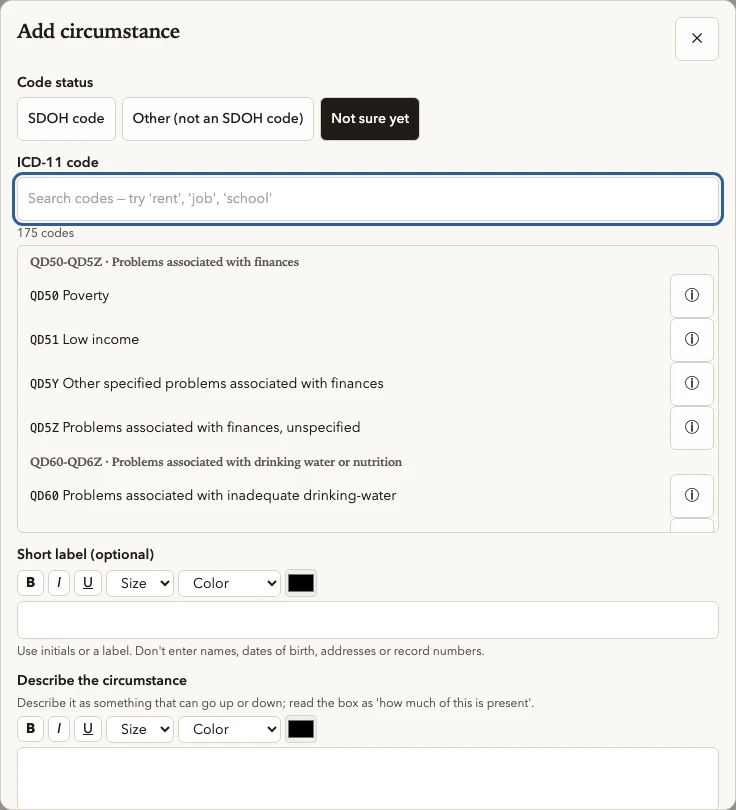

| Field or control | What it does |
|---|---|
| **Code status** | **SDOH code**: an ICD-11 code from the app's set (Chapter 24, blocks QD50–QE9Z, plus a few "functioning" codes). **Other (not an SDOH code)**: anything outside that set, such as an outcome or a policy. **Not sure yet**: decide later; it's listed under *Needs a code*. *Not sure yet* is preselected. |
| **ICD-11 code: Search codes** | Type plain words: "rent", "job", "school", "evict". Results are grouped by ICD-11 block, and the count shows how many match. **×** clears the search. |
| **A code in the list** | Click it to choose it. *Chosen:* repeats your choice below the list. |
| **ⓘ** (*About QD…*) | WHO's own text for that code (title, definition, inclusions and exclusions) without choosing it. |
| **Builder alias** marker | Some everyday words aren't ICD-11 index terms. "evict", for example, finds *QD71.Z Problems associated with housing, unspecified*, marked as the builder's alias, not WHO's. |
| **Short label (optional)** | The words on the box. Without a label, the box shows the ICD-11 title. |
| **Describe the circumstance** | Write it as something that can go up or down. *Read the box as "how much of this is present".* |
| **Text toolbar: B, I, U** | Bold, italic, underline (⌘B, ⌘I, ⌘U). |
| **Text toolbar: Size** | Small, medium, large or extra large text for the selection. |
| **Text toolbar: Color** and the **swatch** (*Custom text color*) | A named color from the list, or any color from the swatch picker. |
| **Add circumstance** | Adds the box and selects it. |
| **Cancel** or **×** | Closes without adding. Esc does the same. |

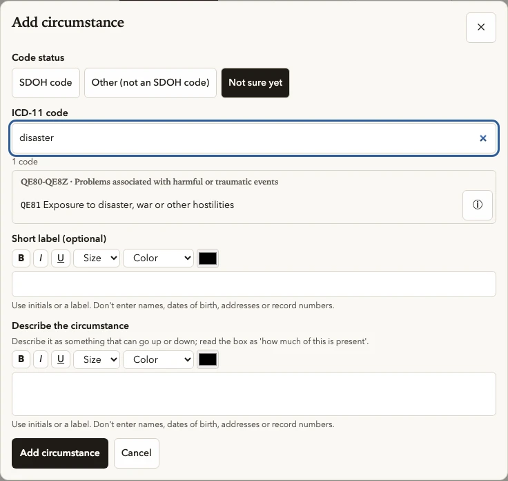
*Searching "disaster" finds QE81. Each result has an ⓘ button for WHO's text.*

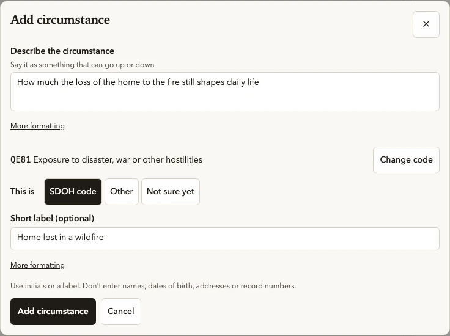

With **Other (not an SDOH code)** the code search is replaced by two fields:

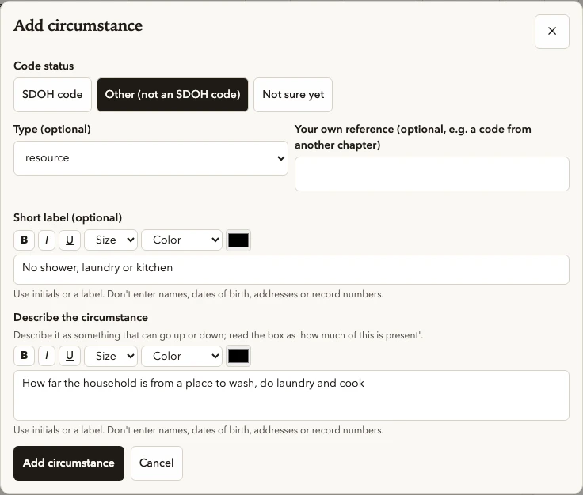

| Field | What it does |
|---|---|
| **Type (optional)** | *outcome, policy, event, resource, personal* or *other*. It's shown on the box ("Other · resource"). |
| **Your own reference (optional, e.g. a code from another chapter)** | Free text, marked *user-entered*. Useful for a code outside Chapter 24. |

An *Other* circumstance has no SDOH code, so the evidence check can't back links to or from it. Those links are
always overrides (section 9).

### On the canvas

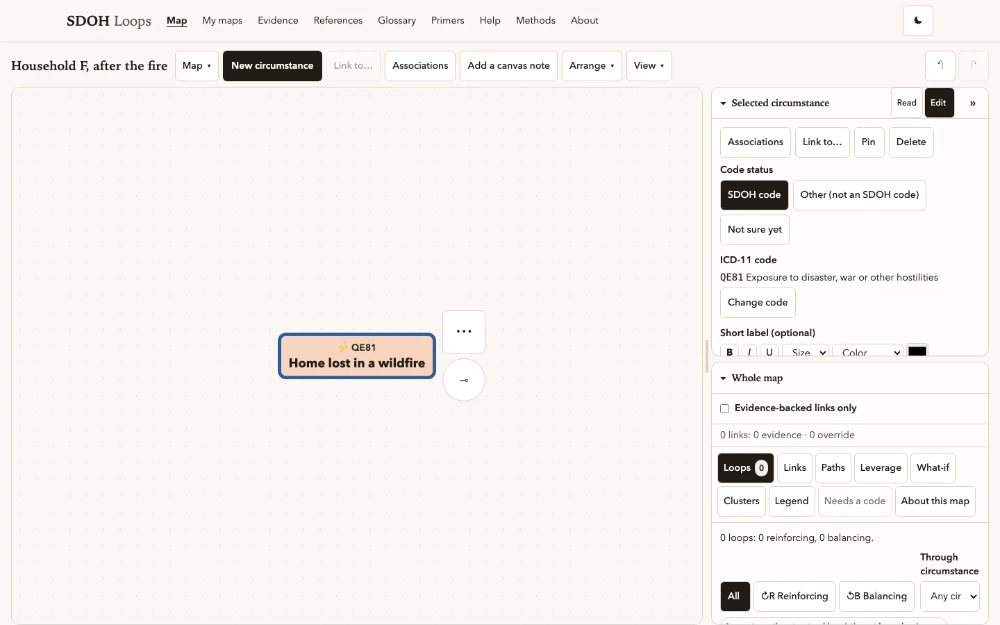

- The box shows the block's **symbol**, the **code** and the **label**. Its **color** comes from the ICD-11 block.
  *Other* and *Not sure yet* boxes have a **dashed** border, and *Not sure yet* also shows a **?**. The Legend tab
  lists every symbol and color (section 10).
- **Click** a box to select it. **Shift-click** adds to the selection, and **Shift-drag** on empty canvas draws a
  selection box.
- **Drag** a box to move it. Moving it doesn't pin it; **Shift + arrow keys** nudge the selected box and do pin it.
- When one box is selected, two round buttons appear beside it:
  - **⋯** (*More actions for the selected circumstance*) opens the association menu (section 8).
  - **⊸** (*Drag to another circumstance to link them*): drag it onto another box to start a link, or click it to
    open **Link to…** from this box.
- **Arrow keys** move the selection between circumstances, **Enter** opens the selection for editing, **Esc**
  clears it and **Del** deletes it.
- **Right-click**, **Ctrl-click** or a **long press** opens the **Quick look** (section 11).

---

## 7. The selection card: Read and Edit

The top card of the side dock shows whatever is selected. Its title says what that is: *Nothing selected*,
*Selected circumstance*, *Selected link*, *Selected canvas note* or *Selected* (several things).

| Control | What it does |
|---|---|
| **▾ / ▸** before the title | Collapses or expands the card. |
| **Read** / **Edit** (E) | Read shows the selection as text, with quick edits. Edit shows the full form. The app remembers your choice. |
| **»** | Folds the whole side dock (section 15). |

### Read mode

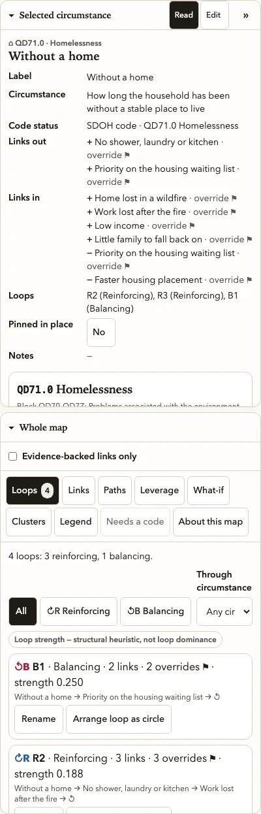

Read mode lists the code and WHO title, the **Label**, the **Circumstance** text, the **Code status**, **Links
out** and **Links in** (each marked *override ⚑* where it's an override), the **Loops** it sits in, **Pinned in
place**, **Notes**, and any notebook **Passages** that support it (section 16.7).

**Quick edit.** Hover a field to show **✎ Edit**; click it to edit just that field without leaving Read mode.

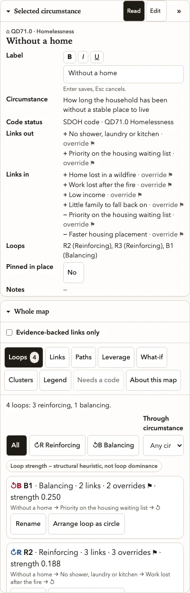

- In single-line fields, **Enter saves** and **Esc cancels**.
- In the multi-line fields (Circumstance, Notes), **Enter saves**, **Shift+Enter** starts a new line, and **Esc**
  cancels.
- **More formatting** switches to Edit mode for the full toolbar.
- **Pinned in place** (circumstances) and **Delay** (links) are switches: click **Yes / No** to flip them.
- Codes, code status, polarity, weight, confidence and overrides are changed in Edit mode only.

### Edit mode: a circumstance

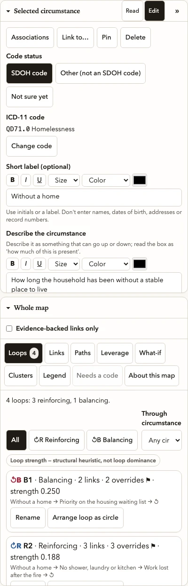 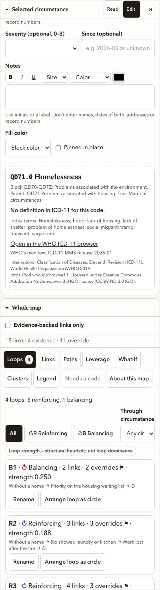

| Control | What it does |
|---|---|
| **Associations** | Opens the association menu (section 8). |
| **Link to…** | Starts a link from this circumstance (section 9). |
| **Pin / Unpin** (P) | A pinned box stays put when you click **Auto-arrange**. |
| **Delete** (Del) | Deletes the circumstance and its links. If notebook passages support it, you're asked whether to **Keep them as plain highlights** or **Remove them** (section 16.6). **Undo** brings it back. |
| **Code status** | As in the add dialog. |
| **ICD-11 code** and **Change code** | Shows the code; *Change code* opens the code search again. A recode re-checks every link that touches the box. A link that loses its evidence turns into *Needs review* ⚑?. |
| **Short label**, **Describe the circumstance** | As in the add dialog. |
| **Severity (optional, 0–3)** | Your rating, or — for none. |
| **Since (optional)** | When it started, in your own words; a year is enough. |
| **Notes** | Free notes on this circumstance (formatted). |
| **Fill color** | *Block color* (the default) or one of ten colors. |
| **Pinned in place** | The same as Pin. |

### The code card

At the foot of the card is WHO's own text for the code:

- the **code and title**; the **block**, the **parent** and the **tier**; and *Residual category* for "other
  specified" or "unspecified" codes;
- the **definition**, verbatim, or *No definition in ICD-11 for this code.* (many Chapter 24 codes have none);
- **Inclusions**, **Exclusions**, **Coded elsewhere** and **Index terms**, where WHO gives them;
- **Open in the WHO ICD-11 browser** (a link to the code's entry) and the line *WHO's own text, ICD-11 MMS release
  2026-01*;
- **Cited in your notebook (n)** when notebook passages cite this code (section 16.7);
- the ICD-11 licence citation.

Codes are shown as WHO publishes them; no mapping to other code sets is included.

---

## 8. Following the research: Associations

Select a coded circumstance and click **Associations**, press **A**, click its **⋯** button, or choose
**Associations…** in the Quick look.

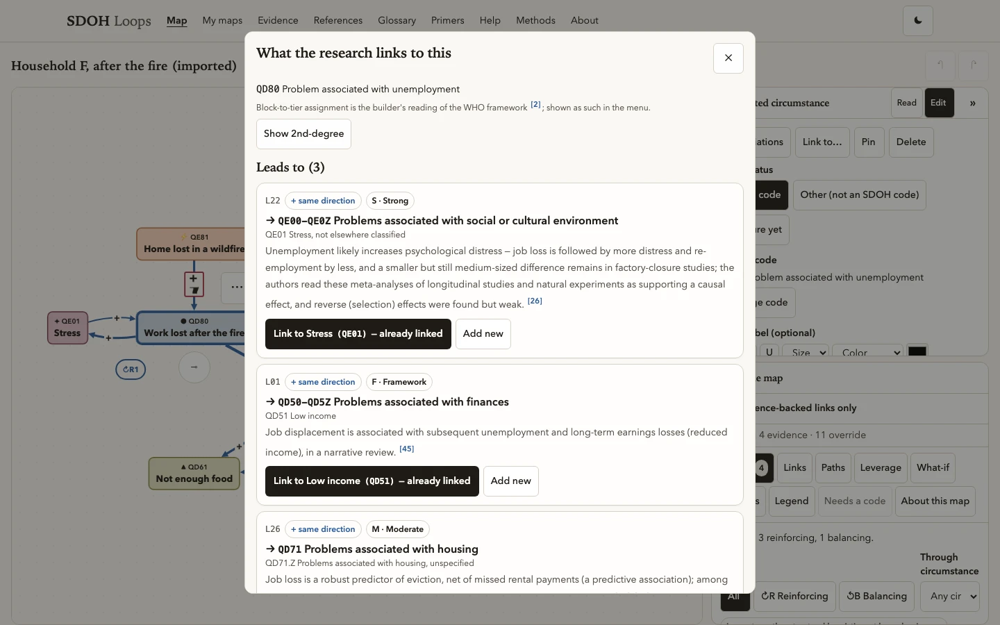

The dialog, *What the research links to this*, lists every evidence link in the app that **leads to** something
from this code, or **comes from** something into it. Each card shows:

- the link's ID (for example **L22**) and its polarity chip (**+ same direction** or **− opposite direction**);
- its grade: **S · Strong** (systematic review or large cohort), **M · Moderate** (one strong study) or
  **F · Framework** (a conceptual source);
- the block and the code it reaches (for example *QE01 Stress, not elsewhere classified*);
- a one-sentence summary of the evidence, with its numbered citations. Click **[26]** to open the reference.

| Control | What it does |
|---|---|
| **Add new** | Adds the other circumstance with the suggested code and draws the evidence-backed link in one step. If several codes fit, choose from **Suggested codes** or **Or choose any code in this block**. |
| **Link to *[circumstance]* (code)** | The other end is already on the map: draws the link to it. *— already linked* means that link exists; clicking adds a second one. |
| **Add a new circumstance and link it yourself** | Opens the add dialog, then the link form. |
| **Show 2nd-degree / Hide 2nd-degree** | Also lists what the research links to the codes one step further out. |
| **× / Esc** | Closes the dialog. |

The note *"Block-to-tier assignment is the builder's reading of the WHO framework [2]"* explains the order: structural
determinants come first, then the intermediary ones they act through. *No evidence-graded links in this pack start or
end here* means the research in the app says nothing about this code.

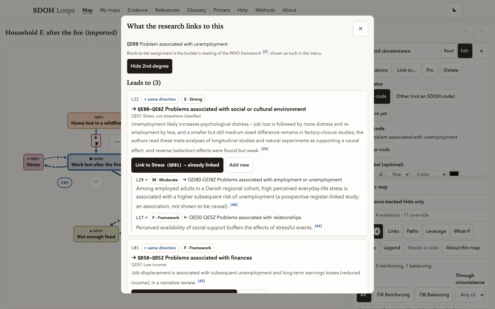

---

## 9. Links (the arrows) and the evidence check

### Drawing a link

Select the circumstance the link starts **from**, then use any of these:

- **Link to…** in the toolbar or the card (or press **K**);
- drag the box's **⊸** handle onto the other box;
- **Add new** or **Link to** in the association menu.

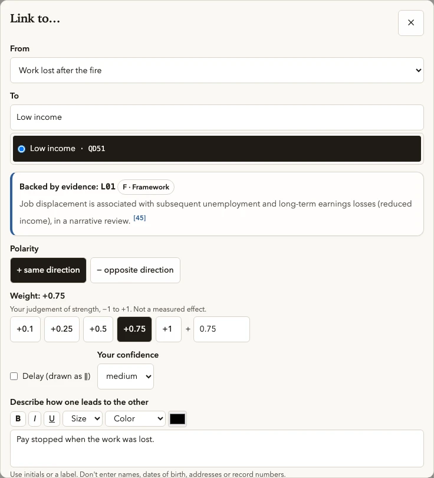

| Field or control | What it does |
|---|---|
| **From** | The starting circumstance. |
| **To** (search, then a radio button) | Search the circumstances on this map, then pick one. *These two are already linked in this direction; this adds a second link* warns you about a duplicate. |
| **Evidence panel** | Updates as you choose. **Backed by evidence: L01** with its grade and summary, or **⚑ Not backed by evidence in this app** with the reason and the **Nearest supported links**. |
| **Use the supported polarity** | Appears when the evidence runs the other way: switches + / −. |
| **Back it with evidence link** | Appears when an evidence link fits after an edit. |
| **Polarity** | **+ same direction** or **− opposite direction**. |
| **Weight** | Your judgment of strength, from −1 to +1. The chips **+0.1, +0.25, +0.5, +0.75, +1** set it (they read **−0.1 … −1** when the polarity is −); the box takes any value. The sign follows the polarity. *Not a measured effect.* |
| **Delay (drawn as ‖)** | Tick it when the effect arrives late. The arrow gets a ‖ mark. |
| **Your confidence** | *low, medium* or *high*: your own rating. |
| **Describe how one leads to the other** | In your own words. |
| **Line** | *solid, dashed* or *dotted*. |
| **Route** | *curved* or *straight*. |
| **Line color** | *By polarity* (blue +, red −) or a fixed color. |
| **Thickness follows \|weight\|** | Stronger links are drawn thicker. |
| **Add link** | Saves. Disabled until an override is confirmed (below). |

### When the evidence doesn't back a link: overrides

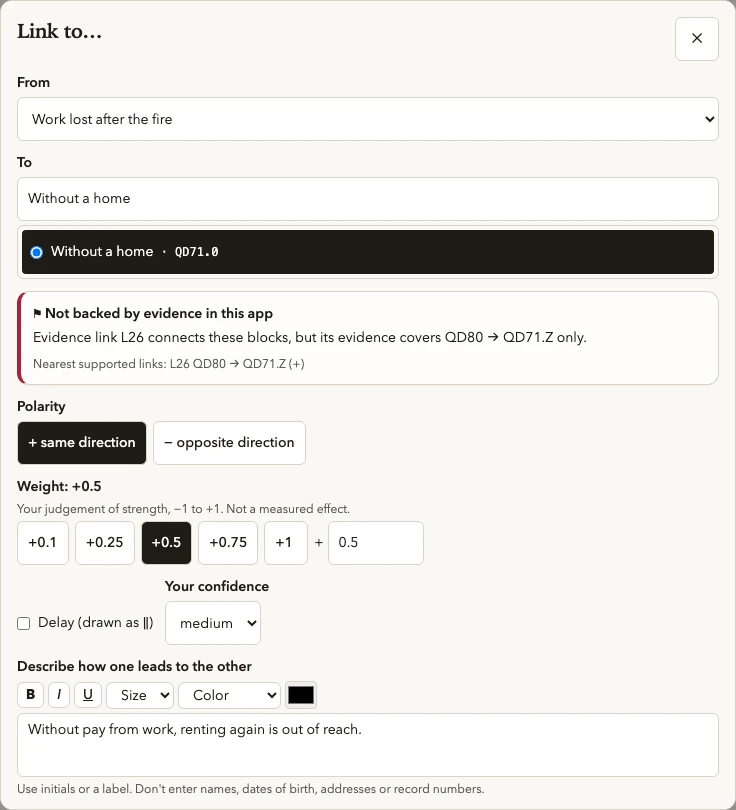

Here *Work lost after the fire* (QD80) → *Without a home* (QD71.0) isn't backed. Evidence link L26 joins the same
**blocks**, but its evidence covers QD80 → **QD71.Z** (eviction) only. The check catches these misses:

- no evidence link joins the two blocks at all;
- a link joins the blocks, but its evidence names other codes (as here);
- the evidence runs the other way, or with the other sign;
- the link was **withheld** after the evidence review (the reasons are on Methods);
- one end has no SDOH code (*Other* or *Not sure yet*).

You can still keep the link as an **override** with a written reason:

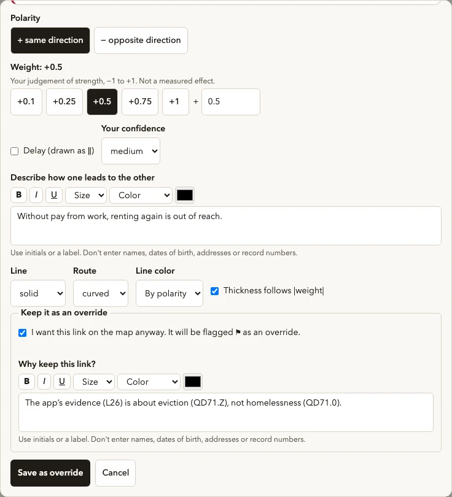

| Control | What it does |
|---|---|
| **I want this link on the map anyway. It will be flagged ⚑ as an override.** | Confirms the override. |
| **Why keep this link?** | Required. For example: "Reported by the household; no study in this app covers it." |
| **Save as override** | Saves the link with a ⚑ flag and the date you confirmed it. |

*This link cannot be saved until you confirm the override and give a reason.* Overrides are normal. They record
what you know from the situation, or a hypothesis to discuss. The **Evidence-backed links only** switch (section 12)
separates them from the research.

**Needs review ⚑?** If a recode or an edit removes a link's evidence, the link turns into *Needs review*, with an
amber glow and ⚑?. Select it, then either confirm it as an override with a reason, or delete it. *Links to review*
in the Links tab lists them.

### The link card

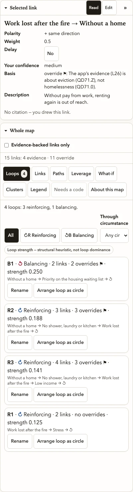 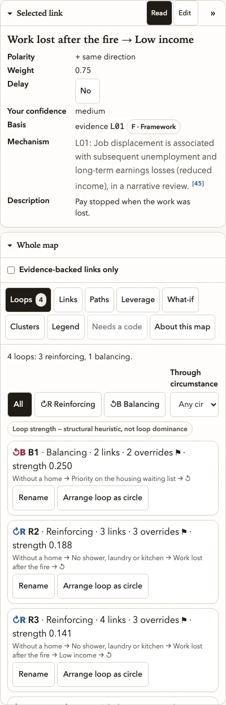

Read mode shows **Polarity**, **Weight**, **Delay** (a Yes / No switch), **Your confidence**, the **Basis**
(*evidence L01* with its grade, or *override ⚑* with your reason), the evidence **Mechanism** with citations, your
**Description**, and the notebook passages that support the link. *No citation — you drew this link* marks a link
that has no evidence.

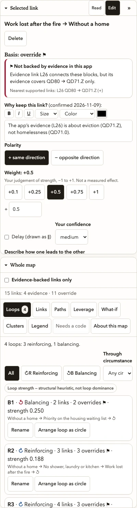 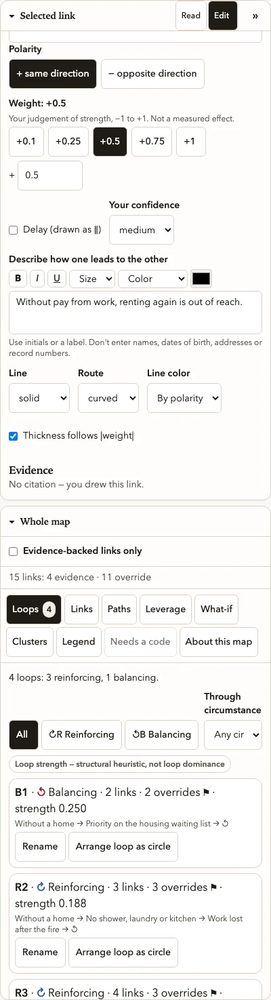

Edit mode adds **Delete**, the evidence panel, **Why keep this link?** (with the date it was confirmed), and every
field from the link form.

*Two links between the same pair have different polarity* warns when you've drawn + and − between the same two
boxes. The methods recommend splitting the circumstance into two instead.

---

## 10. Symbols on the canvas

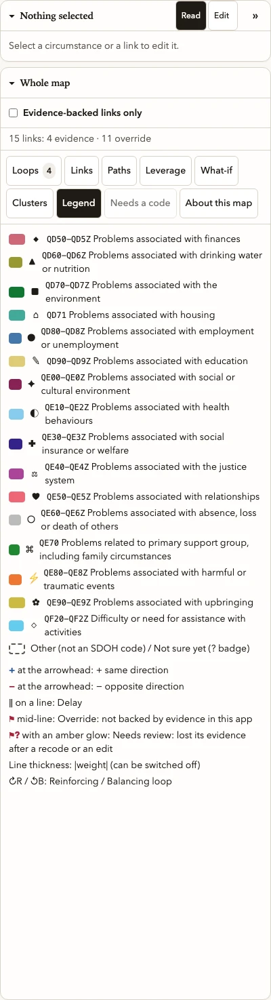

**Box symbols and colors** follow the ICD-11 block. The **Legend** tab is always the authority.

| Symbol | Block |
|---|---|
| ◆ | QD50–QD5Z Problems associated with finances |
| ▲ | QD60–QD6Z Drinking water or nutrition |
| ■ | QD70–QD7Z The environment |
| ⌂ | QD71 Housing |
| ● | QD80–QD8Z Employment or unemployment |
| ✎ | QD90–QD9Z Education |
| ✦ | QE00–QE0Z Social or cultural environment |
| ◐ | QE10–QE2Z Health behaviours |
| ✚ | QE30–QE3Z Social insurance or welfare |
| ⚖ | QE40–QE4Z The justice system |
| ♥ | QE50–QE5Z Relationships |
| ○ | QE60–QE6Z Absence, loss or death of others |
| ⌘ | QE70 Primary support group, including family circumstances |
| ⚡ | QE80–QE8Z Harmful or traumatic events |
| ✿ | QE90–QE9Z Upbringing |
| ◇ | QF20–QF2Z Difficulty or need for assistance with activities |
| dashed border | Other (not an SDOH code); with **?**, Not sure yet |

**Marks on links**

| Mark | Meaning |
|---|---|
| **+** at the arrowhead, blue line | Same direction. |
| **−** at the arrowhead, red line | Opposite direction. |
| **‖** on the line | Delay. |
| **⚑** mid-line | Override: not backed by evidence in this app. Hover it to read the reason. |
| **⚑?** with an amber glow | Needs review: lost its evidence after a recode or an edit. |
| Line thickness | \|weight\|, when *Thickness follows \|weight\|* is on. |
| Dashed or dotted line | A line style you chose (often used for a hypothesis). |

**Loop badges.** **↻R1**, **↻R2**… (blue) are reinforcing loops; **↺B1**… (red) are balancing loops. Each badge sits
inside its loop. Click one to highlight that loop; the badge's tooltip gives the loop's name.

**Highlights.** A thick dark outline marks the selection. Faded boxes and links are outside the current
highlight: a loop, a 1st- or 2nd-degree neighborhood, or Trace (section 16.8).

---

## 11. Quick look (the peek)

**Right-click**, **Ctrl-click** or **long-press** a circumstance or a link, or press **Shift+F10** (or the Menu key)
with something selected.

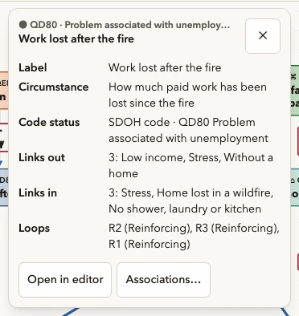

The Quick look is read-only. It shows the label, circumstance, code status, links out and in, and the loops it sits
in; for a link, the polarity, basis, mechanism and description.

| Control | What it does |
|---|---|
| **Open in editor** | Selects it and opens the Edit card. |
| **Associations…** | Opens the association menu (circumstances only). |
| **×** / Esc / a click elsewhere | Closes it. |

---

## 12. The Whole map card: loops and analyses

The lower card of the dock reads the whole map.

**Evidence-backed links only.** With this on, every analysis (loops, links, paths, leverage, what-if, clusters)
uses only the evidence-backed links. The canvas still draws everything, so you can see what the research in the app
supports separately from what rests on judgment.

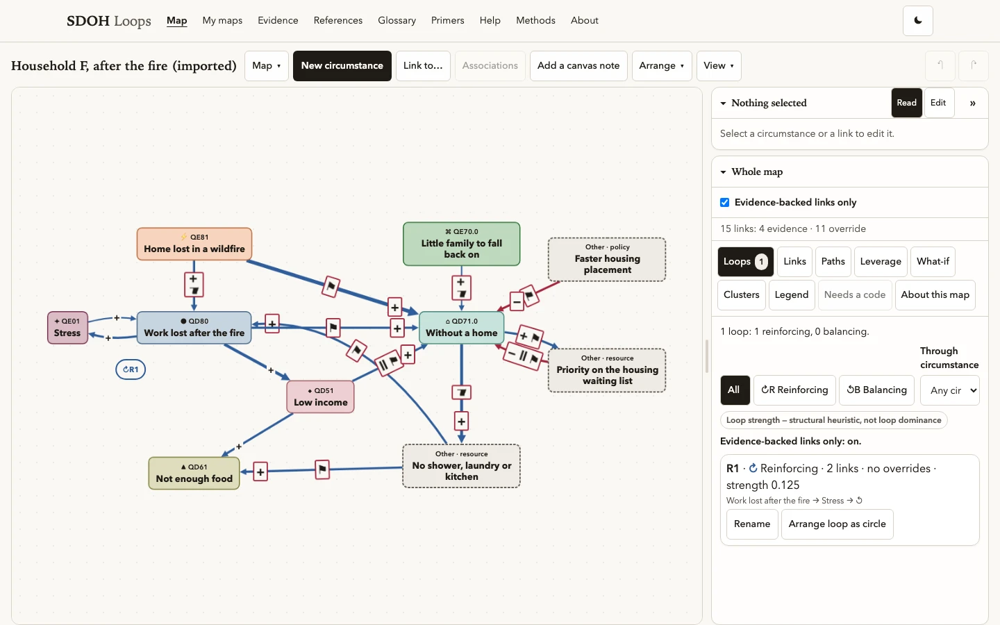
*With the switch on, Household F keeps only R1 (work ⇄ stress), the one loop the evidence closes.*

The **tabs** (the number on *Loops* counts the loops):

### Loops

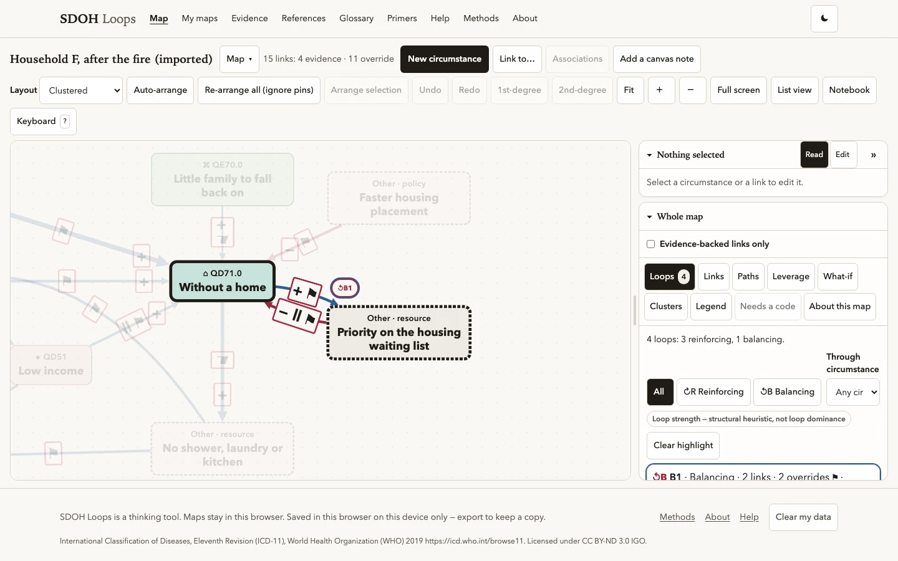

- The summary line, for example *4 loops: 3 reinforcing, 1 balancing.*
- **All · ↻R Reinforcing · ↺B Balancing** filter the list by kind.
- **Through circumstance** (*Any circumstance*, or one box) lists only the loops that pass through that box.
- *Loop strength — structural heuristic, not loop dominance*: strength is the product of the loop's |weights|. It
  ranks loops for discussion; it doesn't say which loop drives the situation.
- Each **loop card** shows the kind, name, length, how many overrides it rests on, its strength, and the path
  (*Without a home → Priority on the housing waiting list → ↻*). Click it to highlight the loop and fit it on the
  canvas.
  - **Rename** gives the loop your own name.
  - **Arrange loop as circle** lays its members out in a ring.
  - **▸ n passages** folds out the notebook passages behind the loop's circumstances, each with **Go to passage**.
- **Clear highlight** ends the highlight.

Loops are numbered in the order the app finds them, so the same loops can get different numbers in a map built in a
different order. Rename them, or refer to them by their circumstances.

### Links

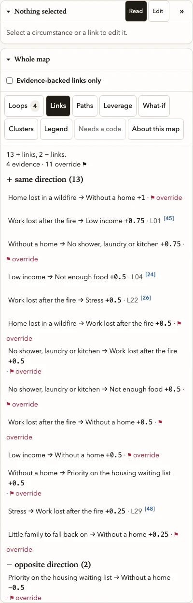

Every link, grouped as **+ same direction** and **− opposite direction**, with its weight and either its evidence ID
(with citations) or **⚑ override**. The header counts them, for example *13 + links, 2 − links. 4 evidence · 11
override.* **Links to review** lists any *Needs review* links.

### Paths

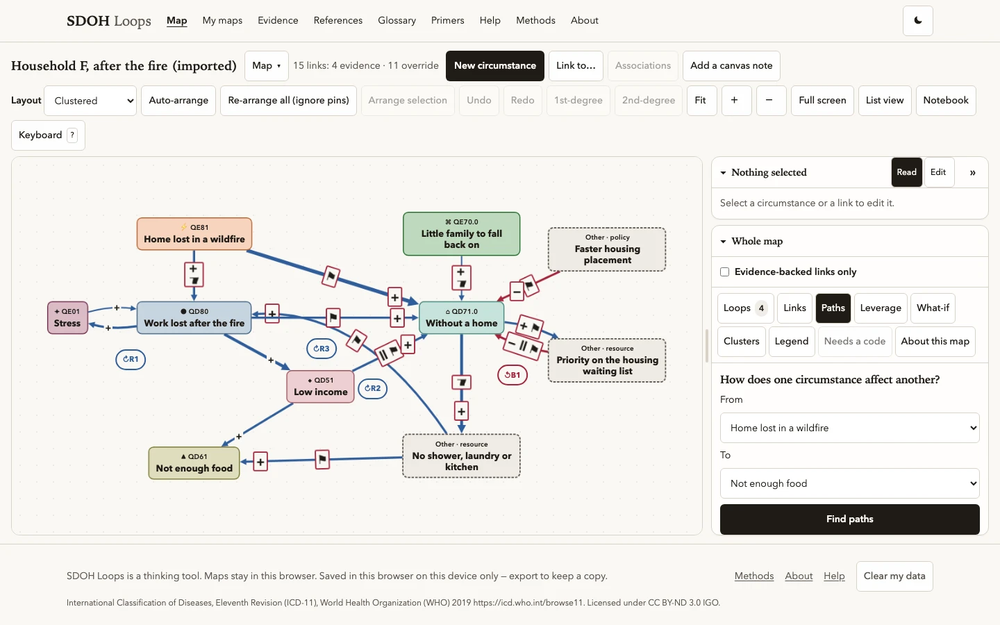

*How does one circumstance affect another?* Choose **From** and **To**, then click **Find paths**. Each path shows
its **sign** (+ or −) and its **weight product**, followed by the route. Click a path to highlight it. The **Net
effect** sums them up. *No path leads from the first to the second* means there's no route.

### Leverage

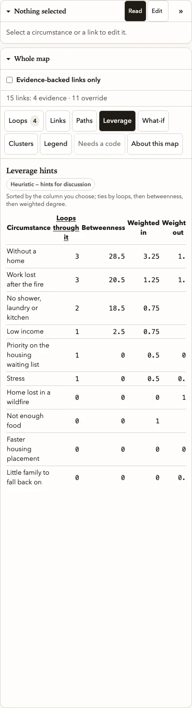

*Leverage hints — Heuristic, hints for discussion.* A table of every circumstance with **Loops through it**,
**Betweenness** (how many shortest routes pass through it), **Weighted in** and **Weighted out**. Click a column
heading to sort by it; ties go by loops, then betweenness, then weighted degree. A circumstance you built the map
around will look central, so treat the table as a prompt, not a finding.

### What-if

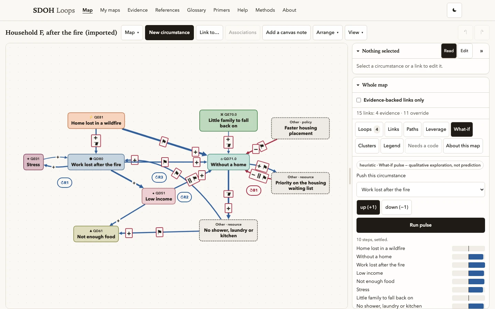 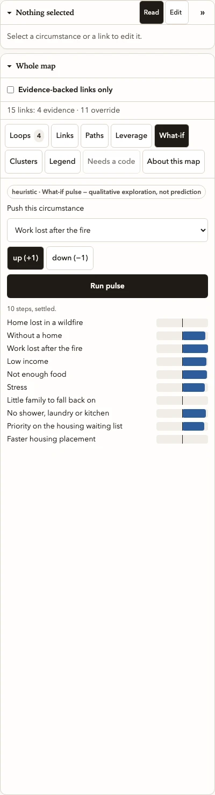

*What-if pulse — qualitative exploration, not prediction.*

1. Choose **Push this circumstance**.
2. Choose **up (+1)** or **down (−1)**.
3. Click **Run pulse**.

The change spreads along the links, step by step, until it settles (*10 steps, settled*) or stops at 30 steps. The
bars show which way each circumstance moved, and roughly how far. Circumstances with no route from the push stay at
zero.

### Clusters

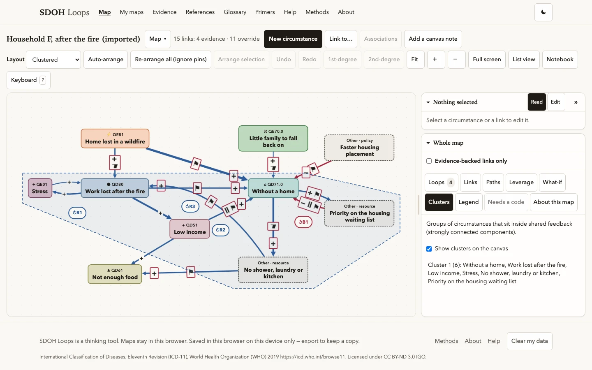

*Groups of circumstances that sit inside shared feedback (strongly connected components).* **Show clusters on the
canvas** draws a dashed outline around each group. Click a cluster to highlight it. Its notebook passages fold out
as in the Loops tab.

### Legend

Every box symbol and link mark (section 10).

### Needs a code

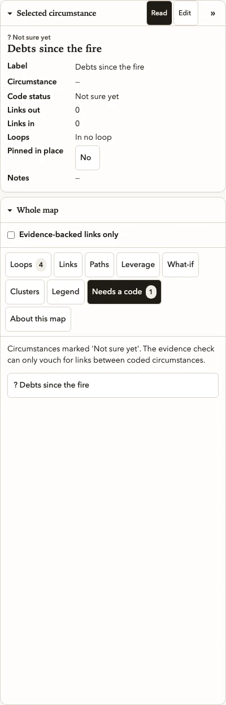

The circumstances still marked *Not sure yet*, with their count on the tab. Click one to select it. The tab is greyed
out when the list would be empty. *The evidence check can only vouch for links between coded circumstances.*

### About this map

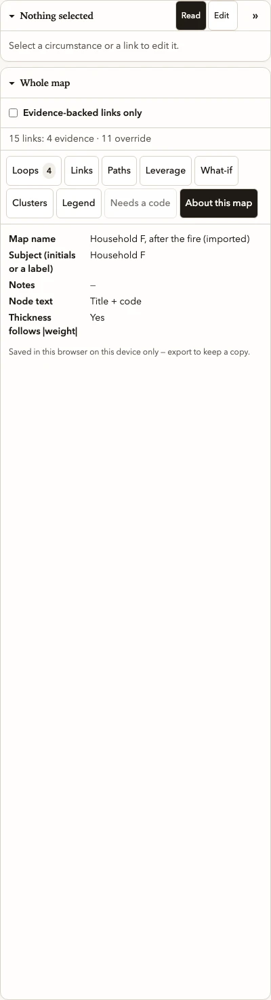

The map's **Map name**, **Subject (initials or a label)** and **Notes**, plus two display settings. In Edit mode you
can change them:

- **Node text**: what the boxes show. *Title* shows the label, or the code's title when there's no label. *Title +
  code* (the default) adds the code line above it. *Full* also adds the start of the description below.
- **Thickness follows |weight|**: for the whole map.

---

## 13. The toolbar in detail

| Control | What it does |
|---|---|
| **New circumstance** (N) | Section 6. |
| **Link to…** (K) | Section 9. Needs a selected circumstance. |
| **Associations** (A) | Section 8. Needs a selected coded circumstance. |
| **Add a canvas note** | A note on the canvas, not a circumstance: no code, no links, ignored by every analysis. Use it for a heading or a reminder. It's edited in the Selected card. 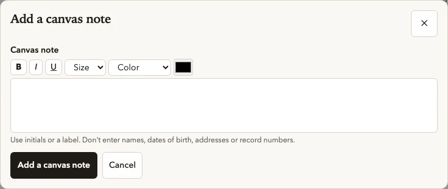 |
| **Layout: Clustered** | Linked circumstances pull together, so groups and loops stand out. |
| **Layout: Evenly spaced** | Distance on screen follows distance in links. |
| **Auto-arrange** (R) | Lays out the map with the chosen layout. Pinned boxes stay put. |
| **Re-arrange all (ignore pins)** | Lays out every box, pinned or not. |
| **Arrange selection** | Lays out only the selected boxes. Needs two or more. |
| **Undo** (⌘Z) / **Redo** (⌘⇧Z) | Step back and forward through your changes to the map. Deleting a note gives its own **Undo** in a short message. Replacing identifiers with labels can't be undone, by design. |
| **1st-degree** (1) | Keeps the selection and its direct neighbors bright and fades the rest. Click again to turn it off. |
| **2nd-degree** (2) | Reaches one step further. |
| **Fit** | Zooms and pans to show the whole map. |
| **+ / −** | Zoom in and out. The mouse wheel or trackpad also zooms, and dragging empty canvas pans. |
| **Full screen** (F) | Section 15. |
| **List view / Canvas view** | Section 15. |
| **Notebook** | Section 16. When notes have possible identifiers, the button shows **⚠ n**. |
| **Trace** | With the notebook open: section 16.8. |
| **Keyboard ?** (?) | The shortcut list (section 22). |

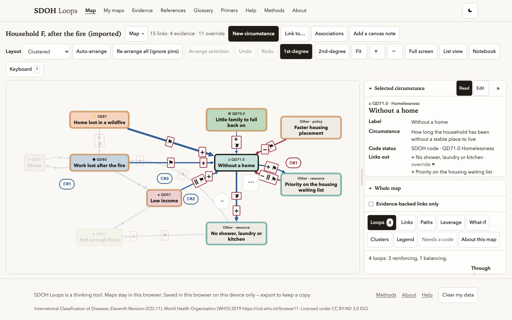
*1st-degree on "Without a home": its seven neighbors stay bright.*

---

## 14. The Map menu: open, save, export, print

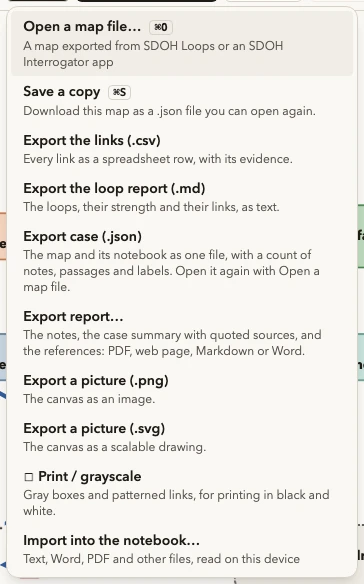

| Item | What it does |
|---|---|
| **Open a map file…** (⌘O / Ctrl+O) | As on My maps: opens a map or case file as a new map. |
| **Save a copy** (⌘S / Ctrl+S) | Downloads `name.sdohmap.json`: the map **and its notebook**. Open it again with *Open a map file*. |
| **Save a copy without the notebook** | The map alone; the notes stay on this device. |
| **Export the links (.csv)** | Every link as a spreadsheet row, with its evidence (`name-edges.csv`). |
| **Export the loop report (.md)** | The loops, their strength and their links, as Markdown text (`name-loops.md`). |
| **Export case (.json)** | The map and its notebook as one file (`name.sdohcase.json`), with a count of notes, passages and labels. It never includes the text of an identifier. |
| **Export report…** | The case report: notes, case summary with quoted sources, and references (section 16.10). |
| **Export a picture (.png)** | The canvas as an image. |
| **Export a picture (.svg)** | The canvas as a scalable drawing. |
| **☐ Print / grayscale** | Redraws the map with gray boxes and patterned links, for printing in black and white. Choose it again to switch back (☑ when on). |
| **Import into the notebook…** | The same as **Import a file…** in the notebook (section 16.9). |

Every export carries the ICD-11 licence citation. **While the notebook has possible identifiers, every export and
Print warns first** (section 16.4).

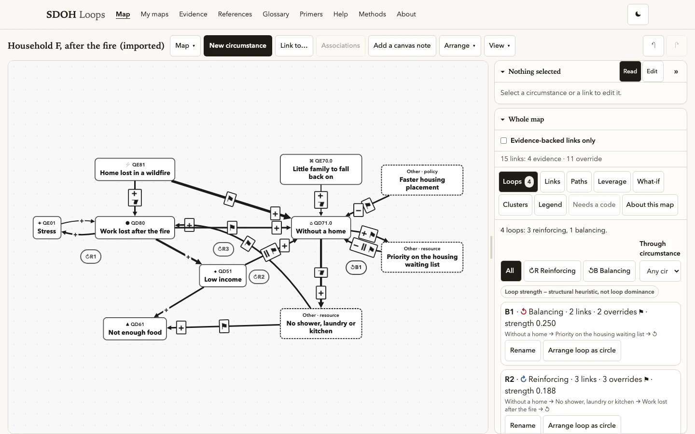

---

## 15. The side dock, list view, full screen

### The side dock

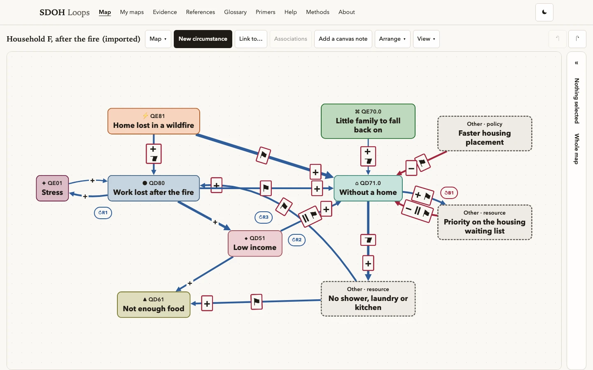

- **»** (*Fold the side dock*, **]**) folds the dock to a thin **rail** on the right, giving the canvas the room.
  **«** (*Open the side dock*) opens it again. The rail's labels, **Nothing selected** (or what's selected) and
  **Whole map**, open the dock at that card.
- **▾** on each card's header collapses that card.
- **Resize**: drag the thin handle between the canvas and the dock. You can also focus it and use **← →**;
  double-click it or press **Home** to reset the width.
- The app remembers the dock's state for you in this browser.
- When the notebook opens on a screen narrower than about 1600 px, the dock folds itself once to make room
  (*"The side dock is folded to make room; press ] to open it again."*).

### List view

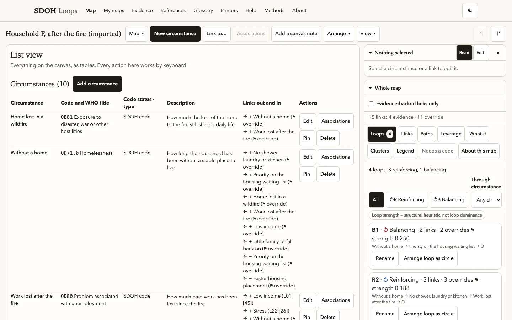

**List view** shows everything on the canvas as tables, and every action in it works by keyboard. It suits screen
readers, and it's handy for checking a map line by line.

- **Circumstances (n)**: each with its code and WHO title, code status and type, description, and links out and in.
  Actions: **Edit**, **Associations**, **Pin**, **Delete**. **Add circumstance** adds one.
- **Links (n)**: each with its basis. Actions: **Edit**, **Delete**. **Add link** adds one.
- **Canvas view** in the toolbar goes back to the drawing.

### Full screen

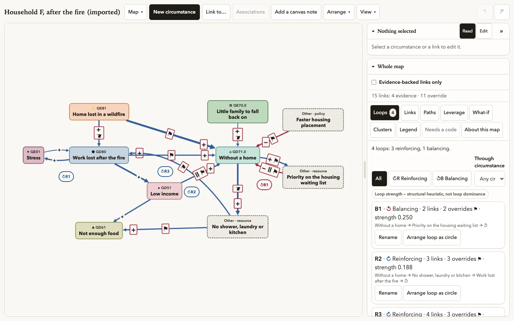

**Full screen** (F) makes the toolbar, canvas and dock fill the screen. **Exit full screen** or **Esc** leaves. If the
browser refuses full screen (some embedded browsers do), the app fills the window instead.

---

## 16. The notebook

The notebook keeps case notes **inside the map**, beside the canvas. You can tie any passage of a note to what it
supports on the map. Notes are saved in this browser as you type and leave only when you export.

Click **Notebook** in the toolbar to open it. On a phone, **Map** and **Notebook** become two tabs.

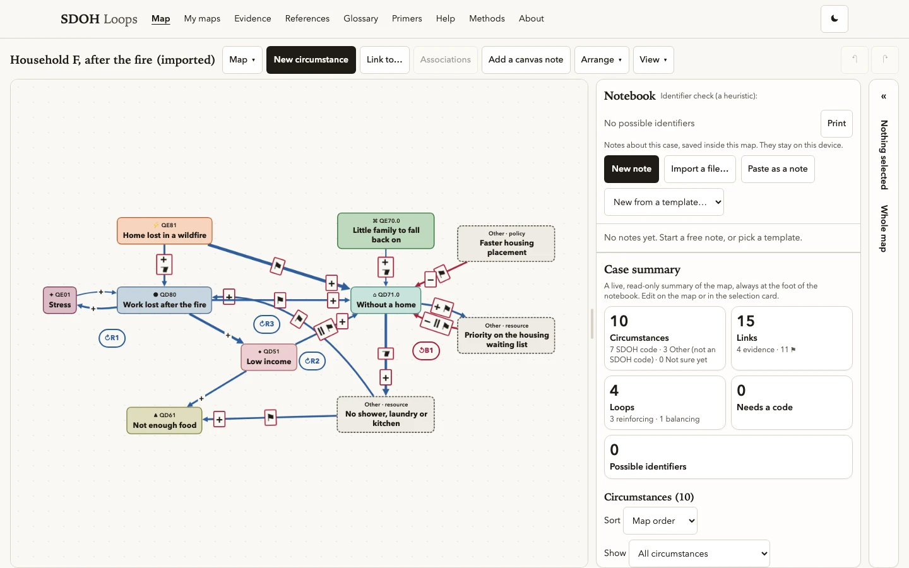

### 16.1 The notebook header

| Control | What it does |
|---|---|
| **Identifier check (a heuristic):** *No possible identifiers* or **⚠ n possible identifiers** | The live result of the identifier check. Click the count to open the list (16.4). |
| **Print** | Prints the notebook. It warns first if possible identifiers remain. |
| **New note** | Starts a free note. |
| **Import a file…** | Reads text, Markdown, Word (.docx), PDF, web page, RTF or CSV files on this device, as notes (16.9). You can also drop files onto the notebook. |
| **Paste as a note** | Paste text, give it a title, then **Review and save** (16.9). |
| **New from a template…** | A note with headed fields: **Intake**, **Contact note**, **Case conference** or **Plan review**. |
| **Search the notes** | Finds words in any note's title, tags or text. |
| **All tags** (*Filter by tag*) | Shows only the notes with one tag. |
| **Resize handle** | Between the notebook and the canvas: drag it, or focus it and use ← →; double-click or Home resets it. |

### 16.2 The note list

Each row shows the note's **title**, its kind (*Free note*, the template's name, or *Imported · TXT* and so on) and,
when it has any, **⚠ n** possible identifiers.

- **Click a row** to open that note. Click it again (or press **Esc** in the list) to collapse it.
- **⋮⋮** is the drag handle: drag to reorder. With a row focused, **Alt+↑ / Alt+↓** move it.
- Notes start collapsed, so the list and the case summary sit together. An empty, untitled note is tidied away
  when you leave it, with an **Undo**.

### 16.3 Writing a note

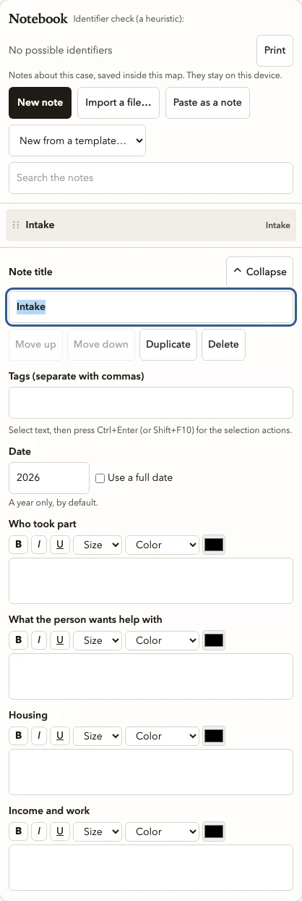

| Control | What it does |
|---|---|
| **Note title** | The note's name in the list. |
| **^ Collapse** | Closes the note so the list and the summary sit together. |
| **Move up / Move down** | Reorders the note. |
| **Duplicate** | Copies the note ("… copy"). |
| **Delete** | Deletes it. A message offers **Undo**, and **Dismiss** closes the message. |
| **Tags (separate with commas)** | Groups notes. Press Enter or type a comma to add a tag. |
| **Date** | A **year** by default. **Use a full date** allows a day and month, but a full date can identify someone, so it's flagged. |
| **B · I · U · Size · Color · swatch** | Text formatting, as elsewhere. |
| **Heading · Subheading · Bulleted list · Numbered list** | In free notes: structure for longer text. |
| **Template fields** | In a template note: one box per heading (Intake has *Who took part*, *What the person wants help with*, *Housing*, *Income and work*, *Food*, *Transportation*, *Supports and connections*, *Next steps*). |
| **Suggest circumstances in this note** | Section 16.6. |

The hint *"Select text, then press Ctrl+Enter (or Shift+F10) for the selection actions"* sits under the tags.

### 16.4 The identifier check

As you type, the check **underlines** things that may identify someone with a wavy orange line. The header and the
**Notebook ⚠ n** button count them.

Click **⚠ n possible identifiers** to open the list:

| Control | What it does |
|---|---|
| **Replace with a label** | Replaces every copy of that text in the notebook with a label such as **[Person A]** or **[phone]**. The same person keeps the same letter. The original text isn't kept, so Undo can't bring it back. |
| **Not an identifier** | Dismisses the flag in this notebook. |
| **Label them all** | Replaces every flagged item at once. |

**What it looks for:** names after Mr., Ms., Dr. or "my name is"; full dates, and dates of birth after "DOB" or
"born on"; ages ("34-year-old", "age 34"); phone numbers; email and street addresses; cities named with their
state ("Huntsville, AL"); ZIP codes (ZIP+4, or five digits after a state); and SSN-like or record-like numbers.

**What it can't catch:** a name with no title in front of it, a first name or nickname on its own, a place or
employer, a rare detail that points to one person, or a name typed in lower case. A year on its own is never flagged.
**Read your notes yourself before you share anything.**

**Every export and Print warns while flags remain:**

- **Label them all, then continue**: labels everything, then exports.
- **Continue anyway**: exports as it is.
- **Cancel**: does nothing.

![After labelling: [Person A] and [phone]](img/54-labelled.webp)

### 16.5 Passages: tying text to the map

Select some words in a note. The **selection actions** bar appears with the quote. With the keyboard, press
**Ctrl+Enter** or **Shift+F10**.

| Action | What it does |
|---|---|
| **Create circumstance** | Opens the add dialog with the quote, and **Suggested codes** matched on this device against WHO titles, index terms and search aliases. Nothing is chosen for you. Pick a code, **Not sure yet**, **Other (not an SDOH code)** or **Search all codes**. The new circumstance keeps the passage as its source.  |
| **Add as evidence to…** | Attaches the passage to an existing circumstance or link. Search, then pick from **Circumstances** or **Links**.  |
| **Link to…** | Ties the passage to anything: circumstances, links, loops, clusters, ICD-11 codes, references, glossary terms, primers, other notes or passages. **Draw a new link between two circumstances…** opens the link form with the passage as its source.  |
| **Annotate** | Adds a **Comment** to the selection. **Save comment** keeps it; **Back** returns.  |
| **Copy quote** | Copies the words, in quotation marks. |

Passages are underlined in the note text; the one you're working with is outlined. Under the note, **n passages** lists each one with what it **Supports**, its comment, and these controls:

- **Annotate / Edit comment** changes the comment.
- **Remove passage** deletes the passage (the note text stays).
- **The target** (for example *No shower, laundry or kitchen → Work lost after the fire*) selects it on the map.

*A highlight only: it supports nothing on the map* marks a plain highlight. **Orphaned selections** lists passages
whose words were edited or deleted. They're kept, not moved to other words. When the caret sits in overlapping
passages, **Passages here** lets you choose one.

**@ mentions.** Type **@** at the start of a word to open **Mention…**: search, then pick what to mention. The
mention is inserted as a chip, such as **@Without a home**, that links to it. **Esc** types a plain @ instead. An @
inside a word, as in an email address, never opens the picker.

### 16.6 Suggest circumstances

**Suggest circumstances in this note** reads each sentence on this device and proposes ICD-11 codes. It matches the
sentence's words against WHO's titles, index terms and the app's search aliases. Each suggestion shows the code, why
it matched (*The words "Food" match "Inadequate food" in WHO's text*), that it's **inferred — open to your
judgment**, a confidence, and *suggested by: Local code matcher*.

| Control | What it does |
|---|---|
| **Accept** | Adds the circumstance with that code, and the sentence as its passage. |
| **Edit then accept** | Opens the add dialog first, so you can change the code or the label. |
| **Reject** | Drops the suggestion. |

A word match isn't a finding. In the example the matcher proposed *Problems associated with housing* from the word
"behind" in "falling behind at school". Reject anything that doesn't fit. Suggestions are refused while the note
still has possible identifiers (*Label or dismiss them first*). When more than one suggestion engine is installed,
an **Engine** picker appears. An engine marked *sends text off this device* is never allowed in this app.

When you **delete** a circumstance or link that passages support, the app asks what to do with them: **Keep them as
plain highlights**, **Remove them** or **Cancel**.

### 16.7 From the map back to the notes

- A circumstance's or link's Read card lists its **Passages** (*In the notebook*), each with **Go to passage** and
  **Remove as evidence**.
- The **Loops** and **Clusters** tabs fold out the passages behind each loop's circumstances (**▸ n passages →
  Go to passage**).
- Codes, references, glossary terms and primers show **Cited in your notebook (n)** wherever they open: in the map,
  and on the References, Glossary and Primers pages. Each entry links back to its passage.

### 16.8 Trace

With the notebook open, **Trace** dims everything not connected to the passage the caret is in, or else to the
selection, on the canvas and in the notes. Click **Trace** again to turn it off.

*With the caret in "she missed two job interviews", Trace keeps only that passage's link, No shower, laundry or
kitchen → Work lost after the fire, and the boxes it joins bright.*

### 16.9 Importing files and pasted text

**Import a file…** (or **Map ▾ → Import into the notebook…**, or dropping files) reads each file **on this device**:
nothing is uploaded. The supported files are text, Markdown, Word (.docx), PDF (its text layer only, so a scanned PDF
has no text to read yet), web pages, RTF and CSV. **Paste as a note** does the same for pasted text.

Before a file becomes a note, the identifier check runs over it:

| Control | What it does |
|---|---|
| **Label all** | Replaces every possible identifier with a label, then saves the note. |
| **Review one by one** | Steps through each flag: **Replace with a label** or **Not an identifier**. |
| **Keep as is** | Saves it unchanged, after a confirmation (*Yes, keep as is* / *Back*), because it goes into every export. |
| **Skip this file** | Doesn't import it. |
| **Save the note** | Appears when nothing was found. |
| **Done / Close** | Ends the import and lists what was **Saved to the notebook** and **Skipped**. |

The original file isn't kept: only the text you see is saved. Its author, title and other properties aren't read.
Imported text stays as it was read. You can change its title and tags, and labels still replace identifiers.

### 16.10 The case summary, case export and the report

At the foot of the notebook, the **Case summary** is a live, read-only view of the map.

- **Tiles**: *Circumstances* (by code status), *Links* (evidence and ⚑), *Loops* (reinforcing and balancing), *Needs
  a code*, and *Possible identifiers*.
- **Circumstances (n)**: a table with its **Sort** (*Map order, Name, Code, Code status, Most links*) and **Show**
  (*All circumstances*, a code status, a block, or *Leverage, top 5*) controls. The **Sources** column counts each
  row's passages and has **Go to passage**. Click a circumstance's name to select it on the map.
- **Loops**: each loop (for example *R1 · Reinforcing: Work lost after the fire → Stress*), with its passages.
  Click one to highlight it on the canvas.

**Export case (.json)** (Map menu) saves the map and its notebook as one `.sdohcase.json` file, with a provenance
count of notes, passages, mentions, labels and pins. It never includes an identifier's text. **Open a map file**
restores both sides.

**Export report…** (Map menu) makes the case report:

| Option | What it does |
|---|---|
| **Format** | **Print / Save as PDF** (your browser's print dialog), **Web page (.html, one file)**, **Markdown (.md)** or **Word (.docx)**. |
| **Include: The notes** | The notes themselves. |
| **Include: The map as a picture** | A picture of the canvas. It needs the canvas view. |
| **Include: Comments, mentions and each note's passages** | The annotations. |
| **Export / Cancel** | Makes the report, or doesn't. |

*The cover says that the identifier check is a heuristic. Possible identifiers go through the usual warning first.*
The report is built in your browser; nothing is sent anywhere.

---

## 17. The research pages

Numbers in square brackets anywhere in the app, such as **[45]**, are citations: click one to open that reference.
Underlined terms in primers and glossary entries open a short definition (*…: definition*).

### Evidence

The **23 evidence-graded links** behind the association menu. Each card shows the link's ID, polarity and grade, the
two blocks it joins, **Backs only** (exactly which codes it covers, for example *QD80 → QD51 (and their
sub-codes)*), and the evidence summary with citations. The *Problem framing* note explains how to read them: each
node is the severity of a circumstance, and + means more of A tends to come with more of B.

| Control | What it does |
|---|---|
| **Grade** | *All grades*, *S — Systematic review, meta-analysis or large cohort*, *M — Single strong study or field experiment*, or *F — Framework or conceptual source*. |
| **Block** | Only the links that start or end in one ICD-11 block. |

### References

All **69 works**, every one verified, grouped by tier: **Seminal** (the works that defined the field, oldest first),
**Classic**, **Current** (newest first) and **Background** (methods and sources the app relies on). Each card shows
its number, tier and year, the citation, a **Summary**, **Why it mattered** (for seminal works), **Used by** (the
links and pages that cite it) and, where the notebook cites it, **Cited in your notebook**.

| Control | What it does |
|---|---|
| **▸ Abstract, verbatim** | Folds out the abstract as published, with its source and the date it was harvested. *No abstract harvested* marks one the app doesn't have. |
| **Open the source (doi:…)** | Opens the publisher's page in a new tab. |

### Glossary

The terms the app and its primers use. Each has a one-line meaning, a fuller definition with citations, and links to
its **Primer** and to related terms (**See also**). *Z codes* explains the US ICD-10-CM categories that play a
similar role to ICD-11's Chapter 24.

### Primers

 

Five short introductions: *ICD-11 codes for social circumstances*, *Reading a causal loop diagram*, *Structural and
intermediary determinants*, *Weights on links*, and *What social determinants of health are*. Each opens with a one-line
summary and a note on how the map uses the idea. Then come *What it is*, *The maths, gently* (where there is any),
*How this app uses it*, and **Further reading** links. **Primers** at the top goes back to the list.

### Help

*Where to get help*: the services the app lists, each with its source and the date it was checked. Below them, the
**notebook** guide and the **identifier check**'s full description, including what it can't catch.

### Methods

Where every fact comes from:

- **Provenance counts**: codes, definitions, topic tags, links offered and withheld, references and terms.
- **provenance.json** and **staleness.json**: the same facts, machine-readable.
- **Sources of ICD-11 text**, with **▸ Known gaps in the code extraction**.
- **Heuristics and their labels**: loop strength, leverage hints, the what-if pulse and the association menu's tier
  order, each with the label the app shows wherever it renders.
- **TODO(author)**: every open research item, shown in amber. Nothing in this list is presented as fact.
- The links that were withheld after the evidence review, and why.

### About

Who built the app and when, the research behind it, the **safety profile** in plain words, the code release, WHO's
citation, the licence and permissions, where data is stored, and how to **report an error**. On this public site
that includes **the repository's Issues page**.

### Page not found

An address that doesn't exist shows **Page not found** and **Back to the start**.

---

## 18. Phones, dark mode and the keyboard

### Phones and narrow screens

  

*390 px wide.*

- The site navigation folds into **Menu**.
- The toolbar keeps the main actions and folds the rest into **More ▾**. **More ▴** closes it again.
- **Map** and **Notebook** are tabs; the dock's cards sit below the canvas.
- On a touch screen, **tap** a circumstance's **⋯** button for the association menu, and **long-press** a
  circumstance or a link for the Quick look. *Tap New circumstance to add the first circumstance.*

### Dark mode

**☾** in the header switches to dark colors, and **☀** switches back. Prints and exported pictures always use light
colors.

### Keyboard and screen readers

Everything works without a mouse. The canvas announces *"Map canvas. Use the arrow keys to move between
circumstances, Enter to edit, A for associations, N for a new circumstance, and ? for every key."* **List view**
presents the whole map as tables. The full list of keys is in section 22.

---

## 19. Worked example: Household F, after the fire

> **Household F is fictional.** Its circumstances follow a common path after a home is lost to fire, and are shaped
> on the kind of situation described in the SDOH Interrogator's displacement interview, but no detail comes from a
> real person. The notes quoted below were written for this manual.

**Get it:** download [`household-f.sdohmap.json`](household-f.sdohmap.json) and open it with **My maps → Open a map
file…**. It opens as *Household F, after the fire (imported)*.

### The situation

A household's home was destroyed in a wildfire. One adult worked from home, so the work went too. Since the fire
they've slept in a car. With nowhere to wash or cook, job interviews are hard to attend and food spoils. Money is
short, stress is high, and there's little family to stay with. They're on the local housing waiting list.

### Step 1: name the circumstances

| Circumstance (label) | Code status and code | Why this code |
|---|---|---|
| Home lost in a wildfire | SDOH · **QE81** Exposure to disaster, war or other hostilities | Search "disaster". |
| Without a home | SDOH · **QD71.0** Homelessness | Search "homeless". Not QD71.Z (eviction), which is a different situation. |
| Work lost after the fire | SDOH · **QD80** Problem associated with unemployment | Search "unemployment". |
| Low income | SDOH · **QD51** Low income | |
| Not enough food | SDOH · **QD61** Inadequate food | |
| Stress | SDOH · **QE01** Stress, not elsewhere classified | A circumstance code in Chapter 24, not a diagnosis. |
| Little family to fall back on | SDOH · **QE70.0** Inadequate family support | Search "family support". |
| No shower, laundry or kitchen | Other · *resource* | ICD-11 has no code for this, and it matters here. |
| Priority on the housing waiting list | Other · *resource* | A local rule, not a social circumstance. |
| Faster housing placement | Other · *policy* | A policy idea to discuss. |

Each one is described as something that can go up or down. For example, *"How long the household has been without a
stable place to live"*.

### Step 2: let the evidence suggest links

Select **Work lost after the fire** and click **Associations**. The research in the app links unemployment to
**stress** (L22, *S · Strong*), **low income** (L01, *F · Framework*) and **eviction** (L26, *M · Moderate*). Use
**Link to Stress** and **Link to Low income**. Select **Stress**: its menu shows **L29**, stress → unemployment
(*M · Moderate*), which closes the first loop. Select **Low income**: **L04** links it to **inadequate food**.

These four links are **evidence-backed**: L01, L04, L22 and L29.

### Step 3: draw what you know, honestly flagged

The rest of the story isn't covered by a study in the app, so those links are **overrides** with reasons:

| Link | Polarity, weight | Reason given |
|---|---|---|
| Home lost in a wildfire → Without a home | +, 1 | Disaster caused the loss of the home; no study in this app covers disaster → homelessness. |
| Home lost in a wildfire → Work lost after the fire | +, 0.5 | Specific to this household: the workplace was the home. |
| Without a home → No shower, laundry or kitchen | +, 0.75 | A direct consequence described by the household. |
| No shower, laundry or kitchen → Work lost after the fire | +, 0.5 | Reported by the household. |
| No shower, laundry or kitchen → Not enough food | +, 0.5 | Reported by the household. |
| Work lost after the fire → Without a home | +, 0.5 | The app's evidence (L26) is about eviction (QD71.Z), not homelessness (QD71.0). |
| Low income → Without a home (‖ delay) | +, 0.5 | The same: L02 is about eviction. |
| Little family to fall back on → Without a home | +, 0.25 | Reported by the household. |
| Without a home → Priority on the housing waiting list | +, 0.5 | How the local list works. |
| Priority on the housing waiting list → Without a home (‖ delay) | −, 0.5 | How the local list works. |
| Faster housing placement → Without a home | −, 0.5 | A policy idea to discuss, not an estimate. |

Note how the check treats **Work lost → Without a home**. L26 joins the same blocks, but its evidence covers eviction
only, so the app says so and names L26 as the nearest supported link. Keeping the link as an override, with that
reason, is more honest than recoding the box as eviction to make it "pass".

*15 links: 4 evidence · 11 override.*

### Step 4: read the loops

The **Loops** tab finds four:

| Loop | Kind | Path | Links · overrides | Strength |
|---|---|---|---|---|
| **B1** | ↺ Balancing | Without a home → Priority on the waiting list → back | 2 · 2 | 0.250 |
| **R2** | ↻ Reinforcing | Without a home → No shower, laundry or kitchen → Work lost → back | 3 · 3 | 0.188 |
| **R3** | ↻ Reinforcing | Without a home → No shower, laundry or kitchen → Work lost → Low income → back | 4 · 3 | 0.141 |
| **R1** | ↻ Reinforcing | Work lost ⇄ Stress | 2 · 0 | 0.125 |

How to read them:

- **R2 and R3** are the trap: being without a home makes work harder to get, and less work keeps the household
  without a home. Both rest on overrides, which is the household's own account.
- **R1** (work ⇄ stress) is the only loop the research in the app closes by itself. Turn on **Evidence-backed links
  only** and it's the one loop left (screenshot in section 12).
- **B1** is the waiting list's own feedback: the longer without a home, the higher the priority, and the sooner an
  offer. It pushes against the trap, but with a delay (‖), so it acts slowly.
- Strength ranks loops for discussion only. B1 ranks first because both of its weights are 0.5, not because it
  dominates.

### Step 5: ask the other questions

- **Leverage.** *Without a home* sits in three loops and has the highest betweenness (28.5), with *Work lost after
  the fire* close behind (3 loops, 20.5). Both are where many routes cross, which makes them good places to start a
  conversation. They aren't findings.
- **Paths: Home lost in a wildfire → Not enough food.** Five routes, all +. The strongest runs through the lack of
  facilities (weight product 0.375); the next runs through work and income (0.1875).
- **What-if.** Push **Work lost after the fire** up (+1) and run the pulse. It settles in 10 steps: everything
  downstream rises, while the fire, family support and the policy don't move. Push **Faster housing placement** up
  instead, and *Without a home* moves down, because that link is −.
- **Clusters.** One cluster of six circumstances shares feedback: without a home, work, income, stress, facilities
  and the waiting list.

### Step 6: keep the notes with the map

Open **Notebook**, click **New note** and write the visit note. Our example note includes a name after "Ms." and a
phone number, written for this manual, to show the check. The identifier check flags both; **Label them all** turns
them into [Person A] and [phone].

Then tie the note to the map:

- *"she missed two job interviews"* → **Add as evidence to…** the link *No shower, laundry or kitchen → Work lost
  after the fire*. The override now has a source in your own notes.
- *"Food spoils without a fridge"* → **Link to…** *Not enough food*.
- *"slept in the car since the fire"* → **Annotate**: "Ask how many nights a week."
- *"the children are falling behind at school"* → **Create circumstance**. The suggested codes include QD92
  (educational progress). Decide with the household whether it belongs on this map.
- Type *"Next visit: check on @"* and mention **Without a home**.

**Trace** with the caret in a passage shows exactly what it supports. **Export report…** produces a case report with
the notes, the case summary with quoted sources, and the references, ready to print or share once you've read it
for identifiers yourself.

### What the map gives you, and what it doesn't

The map makes a pattern visible: the household's own account describes a reinforcing trap through the lack of basic
facilities, which the research in this app doesn't cover. It also shows where that account and the research
agree (work and stress), and where a policy or the waiting list could push back. It doesn't say which loop
dominates, how big any effect is, or what will happen. Build and check maps like this **with** the people they
describe.

---

## 20. Limits and good practice

- **It's a thinking tool.** It names circumstances. It does not diagnose anyone, and it never recommends a
  clinical action.
- **Weights are judgments.** Loop strength, path weights, leverage and the what-if pulse are computed from them.
  Change a weight and the ranking can change.
- **Structure isn't behavior.** The app reads the diagram's structure. It doesn't simulate change over time, and it
  can't say which loop dominates.
- **"Evidence" means a study in this app** supports these codes in this direction. It isn't proof that the link
  holds for this person. **An override isn't a mistake**: it records knowledge the research in the app doesn't
  cover, and its reason is part of the record.
- **Code honestly.** Don't recode a circumstance to make a link pass the check. Keep the true code and an override
  with a reason (see Household F, step 3).
- **Centrality depends on what you drew.** A circumstance you built the map around will look central.
- **Protect people.** On this prototype, use made-up or fully de-identified cases. Everywhere, use labels, read
  your notes for names yourself, and label identifiers before you export.
- **Build it with the people in it.** A map made with the household or community it describes is better, and more
  likely to be acted on.

---

## 21. Troubleshooting and common questions

**Associations is greyed out.** Select a circumstance first. It needs an SDOH code: *Other* and *Not sure yet*
circumstances have no associations.

**Link to… or Arrange selection is greyed out.** *Link to…* needs one selected circumstance. *Arrange selection*
needs two or more.

**My link shows ⚑.** No evidence link in the app covers that pair of codes in that direction and sign. Select the
link and read *Not backed by evidence in this app* for the reason and the nearest supported links.

**A link turned amber with ⚑?.** A recode or an edit removed its evidence. Confirm it as an override with a reason,
or delete it.

**My maps are gone.** Maps live in one browser on one device. Another browser, a private window, clearing site data
or **Clear my data** all start empty. Keep copies with **Map ▾ → Save a copy**.

**How do I move a map to another computer?** **Save a copy** (or **Export case**), then **Open a map file…** on the
other device. Every link is checked again against that device's evidence.

**The page scrolls, or the canvas is small.** Fold the dock (**»** or **]**), use **Full screen** (**F**), or click
**Fit**. On a phone, use the **Map** tab.

**The banner keeps coming back.** That's by design on the public prototype: **✕** hides it for the current visit
only.

**Full screen doesn't fill the monitor.** Some embedded browsers refuse full screen. The app then fills the window
instead; **Esc** leaves either way.

**Where do the code definitions come from?** From WHO's ICD-11 (MMS release 2026-01), verbatim, under its CC BY-ND 3.0
IGO licence. Many Chapter 24 codes have no written definition, and the app says so rather than inventing one.

**Does the app map ICD-11 codes to other code sets?** No. Codes are shown as WHO publishes them, with no mapping to
other code sets.

**Does anything leave my device?** No. There are no accounts, no analytics and no server storage. Only files you
export leave the browser. *Report a problem* is a plain link to GitHub, and it sends nothing from the app.

**I found a mistake.** Use **Report a problem** in the banner, or follow **About → Report an error**. Say which page
and which code or reference number is involved, and what looks wrong. Don't include client details.

---

## 22. Reference: keyboard shortcuts

On Windows and Linux, read ⌘ as **Ctrl**. The map's keys work when the canvas has focus. **Keyboard ?** in the
toolbar shows the same list in the app:

| Key | Action |
|---|---|
| **N** | New circumstance |
| **K** | New link from the selection |
| **A** | Association menu |
| **E** | Read / Edit the selection |
| **Enter** | Edit the selection |
| **Esc** | Clear the selection; close a dialog; leave full screen |
| **Del** | Delete the selection |
| **P** | Pin / unpin |
| **R** | Auto-arrange |
| **L** | Loops panel |
| **1 / 2** | 1st / 2nd-degree neighborhood |
| **← → ↑ ↓** | Move between circumstances |
| **Shift + arrows** | Nudge the selected circumstance (pins it) |
| **F** | Full screen (Esc leaves) |
| **]** | Fold / open the side dock |
| **Shift+F10** or the **Menu** key | Quick look at the selection |
| **⌘Z / ⌘⇧Z** | Undo / redo |
| **⌘O / ⌘S** | Open a map file / save a copy |
| **⌘B / ⌘I / ⌘U** | Bold / italic / underline while editing text |
| **?** | The keyboard list |
| **Ctrl+Enter** or **Shift+F10** (in a note, with text selected) | Selection actions |
| **@** (at the start of a word, in a note) | Mention… (Esc types a plain @) |
| **Alt+↑ / Alt+↓** (in the note list) | Move the focused note |
| **Enter / Shift+Enter / Esc** (in quick edit) | Save / new line / cancel |

---

## 23. Reference: every control, A to Z

Each entry gives the control's name as it appears on screen, what it does in a few words, and the section with the
details.

| Control | Where | What it does | § |
|---|---|---|---|
| **@ mention** | Note text | Opens *Mention…* to insert a link chip | 16.5 |
| **⋮⋮** (drag handle) | Note list | Drag to reorder notes | 16.2 |
| **⋯** (*More actions for the selected circumstance*) | Beside a selected box | Opens the association menu | 6, 8 |
| **⊸** (*Drag to another circumstance to link them*) | Beside a selected box | Drag to link; click for Link to… | 6, 9 |
| **» / «** (*Fold / Open the side dock*) | Dock | Folds the dock to a rail or opens it | 15 |
| **▾ / ▸** | Card headers, folds | Collapse or expand | 7, 15 |
| **☾ / ☀** (*Dark mode / Light mode*) | Header | Color theme | 18 |
| **✕** (*Hide this notice for this visit*) | Banner | Hides the banner until reload | 3 |
| **× / Close / Cancel** | Dialogs | Closes without changes | — |
| **ⓘ** (*About QD…*) | Code search | WHO's text for a code | 6 |
| **+ / −** (*Zoom in / out*) | Toolbar | Zoom | 13 |
| **+0.1 … +1** | Link form | Weight presets | 9 |
| **+ same direction / − opposite direction** | Link form | Polarity | 9 |
| **1st-degree / 2nd-degree** | Toolbar | Neighborhood highlight | 13 |
| **Abstract, verbatim** | References | Folds out the abstract | 17 |
| **Accept / Edit then accept / Reject** | Suggestions | Act on a suggested circumstance | 16.6 |
| **Add a canvas note** | Toolbar | A free-text note on the canvas | 13 |
| **Add a new circumstance and link it yourself** | Association menu | Add, then link, by hand | 8 |
| **Add as evidence to…** | Selection actions | Attach a passage to a circumstance or link | 16.5 |
| **Add circumstance** | Add dialog, list view | Saves the new circumstance | 6, 15 |
| **Add link** | Link form, list view | Saves the link | 9, 15 |
| **Add new** | Association menu | Adds the suggested circumstance and the evidence link | 8 |
| **All · ↻R Reinforcing · ↺B Balancing** | Loops tab | Filter loops by kind | 12 |
| **All grades / All blocks** | Evidence page | Filter evidence links | 17 |
| **All tags** (*Filter by tag*) | Notebook | Show notes with one tag | 16.1 |
| **Annotate / Edit comment** | Selection actions, passages | Add or change a comment | 16.5 |
| **Arrange loop as circle** | Loop card | Lays a loop out in a ring | 12 |
| **Arrange selection** | Toolbar | Lays out the selected boxes | 13 |
| **Associations** / **Associations…** | Toolbar, card, list view, Quick look | The association menu | 8 |
| **Auto-arrange** | Toolbar | Layout, leaving pinned boxes | 13 |
| **B / I / U** | Text toolbars | Bold, italic, underline | 6 |
| **Back it with evidence link** | Link form | Ties a link to a fitting evidence link | 9 |
| **Betweenness · Loops through it · Weighted in · Weighted out** | Leverage tab | Sort the table | 12 |
| **Bulleted list · Numbered list · Heading · Subheading** | Free note | Structure | 16.3 |
| **Canvas view / List view** | Toolbar | Switch views | 15 |
| **Change code** | Edit card | Recode a circumstance | 7 |
| **Clear highlight** | Loops tab | Ends a loop highlight | 12 |
| **Clear my data** | Footer, My maps | Deletes everything in this browser | 3 |
| **Code status: SDOH code / Other / Not sure yet** | Add dialog, Edit card | What kind of circumstance | 6 |
| **Collapse** (^) | Open note | Collapses the note | 16.3 |
| **Color** and **swatch** | Text toolbars | Text color | 6 |
| **Continue anyway / Label them all, then continue** | Export warning | Export despite flags, or label first | 16.4 |
| **Copy quote** | Selection actions | Copies the selected words | 16.5 |
| **Create circumstance** | Selection actions | A circumstance from a passage | 16.5 |
| **Create map** | My maps | New blank map | 4 |
| **Date / Use a full date** | Note | Year by default; a full date is flagged | 16.3 |
| **Delay (drawn as ‖)** | Link form, link card | Marks a slow effect | 9 |
| **Delete** | Card, list view, My maps, note | Deletes the item (map: with confirmation; note: with Undo) | 4, 7, 16.3 |
| **Describe the circumstance / Describe how one leads to the other** | Forms | Your description | 6, 9 |
| **Draw a new link between two circumstances…** | Link to… (passage) | Link form with the passage as source | 16.5 |
| **Duplicate** | My maps, note | Copies it | 4, 16.3 |
| **Edit** (list view), **✎ Edit** (quick edit) | List view, Read card | Edit a row or one field | 15, 7 |
| **Engine** | Suggestions | Choose a suggestion engine (when there's more than one) | 16.6 |
| **Evidence-backed links only** | Whole map | Analyses on evidence only | 12 |
| **Export (report)** with **Format** and **Include** | Report dialog | Makes the case report | 16.10 |
| **Export a picture (.png / .svg)** | Map menu | Canvas image | 14 |
| **Export case (.json)** | Map menu | Map and notebook in one file | 14, 16.10 |
| **Export report…** | Map menu | The case report | 16.10 |
| **Export the links (.csv)** | Map menu | Links as a spreadsheet | 14 |
| **Export the loop report (.md)** | Map menu | Loops as text | 14 |
| **Fill color** | Edit card | Box color | 7 |
| **Find paths** (From / To) | Paths tab | Routes between two circumstances | 12 |
| **Fit** | Toolbar | Shows the whole map | 13 |
| **Full screen / Exit full screen** | Toolbar | Fills the screen | 15 |
| **Go to passage** | Cards, summary, loop folds | Opens the notebook at a passage | 16.7 |
| **Got it** | First-run notice | Dismisses it | 3 |
| **Hide 2nd-degree / Show 2nd-degree** | Association menu | One step further | 8 |
| **I want this link on the map anyway…** | Link form | Confirms an override | 9 |
| **Import a file… / Import into the notebook…** | Notebook, Map menu | Files as notes | 16.9 |
| **Keep as is / Yes, keep as is / Back** | Import review | Save unchanged after confirming | 16.9 |
| **Keep them as plain highlights / Remove them** | Delete prompt | What happens to supporting passages | 16.6 |
| **Keyboard ?** | Toolbar | The shortcut list | 22 |
| **Label all / Label them all** | Import review, flag list | Replace every flagged item | 16.4, 16.9 |
| **Layout** (Clustered / Evenly spaced) | Toolbar | Layout style | 13 |
| **Line · Route · Line color · Thickness follows \|weight\|** | Link form | How a link is drawn | 9 |
| **Link to…** | Toolbar, card, selection actions | Draw a link; tie a passage to anything | 9, 16.5 |
| **Link to *X* (code)** | Association menu | Link to a circumstance already on the map | 8 |
| **Loop badge** (↻R1, ↺B1…) | Canvas | Highlights that loop | 10 |
| **Map ▾** | Toolbar | The Map menu | 14 |
| **Map name / Subject** | My maps, About this map | The map's name and subject label | 4, 12 |
| **Map / Notebook** (tabs) | Phone | Switch panes | 18 |
| **Menu** | Header (phone) | Site navigation | 18 |
| **More ▾ / More ▴** | Toolbar (phone) | The rest of the toolbar | 18 |
| **More formatting** | Quick edit | Switches to Edit mode | 7 |
| **Move up / Move down** | Note | Reorder | 16.3 |
| **New circumstance** | Toolbar | Add a box | 6 |
| **New from a template…** | Notebook | Intake, Contact note, Case conference, Plan review | 16.1 |
| **New note** | Notebook | A free note | 16.1 |
| **Node text** | About this map | Title, Title + code, Full | 12 |
| **Not an identifier** | Flag list, import review | Dismisses one flag | 16.4 |
| **Notebook** | Toolbar | Show or hide the notebook | 16 |
| **Open a map file…** | My maps, Map menu | Opens a file as a new map | 4, 14 |
| **Open in editor** | Quick look | Edit the item | 11 |
| **Open in the WHO ICD-11 browser** | Code card | WHO's page for the code | 7 |
| **Open the source** | References | Publisher's page | 17 |
| **Paste as a note / Review and save** | Notebook | Pasted text as a note | 16.9 |
| **Pin / Unpin**, **Pinned in place** | Edit card, list view, Read card | Keep a box in place | 7 |
| **Print** | Notebook | Prints the notebook | 16.1 |
| **Print / grayscale** | Map menu | Black-and-white drawing | 14 |
| **Push this circumstance · up (+1) · down (−1) · Run pulse** | What-if tab | The pulse | 12 |
| **Re-arrange all (ignore pins)** | Toolbar | Layout of everything | 13 |
| **Read / Edit** | Selection card | How the selection shows | 7 |
| **Redo / Undo** | Toolbar | Step forward or back | 13 |
| **Remove as evidence** | Read card | Detaches a passage | 16.7 |
| **Remove passage** | Passages list | Deletes a passage | 16.5 |
| **Rename** | My maps, loop card | Rename a map or a loop | 4, 12 |
| **Replace with a label** | Flag list | Labels one identifier everywhere | 16.4 |
| **Report a problem** | Banner, About | GitHub Issues | 3, 17 |
| **Review one by one** | Import review | Step through flags | 16.9 |
| **Save a copy / Save a copy without the notebook** | Map menu | Download the map | 14 |
| **Save as override** | Link form | Saves an override | 9 |
| **Save comment** | Annotate | Saves a comment | 16.5 |
| **Search all codes / Not sure yet / Other** | Create from text | Choose the code another way | 16.5 |
| **Search codes** | Add dialog | Find an ICD-11 code | 6 |
| **Search the notes** | Notebook | Find text in notes | 16.1 |
| **Search circumstances and links / Search everything…** | Pickers | Narrow the list in Add as evidence to…, Link to… and Mention… | 16.5 |
| **See the research / Start a map** | Home | Evidence page / My maps | 3 |
| **Severity (optional, 0–3) · Since (optional) · Notes** | Edit card | Your details | 7 |
| **Show clusters on the canvas** | Clusters tab | Outlines clusters | 12 |
| **Size** | Text toolbars | Text size | 6 |
| **Skip this file** | Import review | Doesn't import it | 16.9 |
| **Skip to main content** | Every page (Tab) | Jumps past navigation | 3 |
| **Sort / Show** | Case summary | Order and filter the table | 16.10 |
| **Suggest circumstances in this note** | Note | Local code suggestions | 16.6 |
| **Tags** | Note | Group notes | 16.3 |
| **Through circumstance** | Loops tab | Loops through one box | 12 |
| **Trace** | Toolbar (notebook open) | Dims what's not connected | 16.8 |
| **Type (optional) · Your own reference** | Other circumstance | Kind and your own code | 6 |
| **Undo** (message) | Notebook | Brings back a deleted note | 16.3 |
| **Use the supported polarity** | Link form | Switches to the evidence's sign | 9 |
| **Weight** (number box) | Link form | Any weight from −1 to +1 | 9 |
| **Your confidence** | Link form | low / medium / high | 9 |
| **Whole map tabs**: Loops, Links, Paths, Leverage, What-if, Clusters, Legend, Needs a code, About this map | Dock | Analyses and settings | 12 |

---

*SDOH Loops is commissioned research, not peer reviewed. This manual describes the public prototype built from
`sdoh-loops-core` 0.10.0 and content pack 0.3.0; research current as of 2026-10-23.*

*International Classification of Diseases, Eleventh Revision (ICD-11), World Health Organization (WHO) 2019
https://icd.who.int/browse11. Licensed under CC BY-ND 3.0 IGO.*
